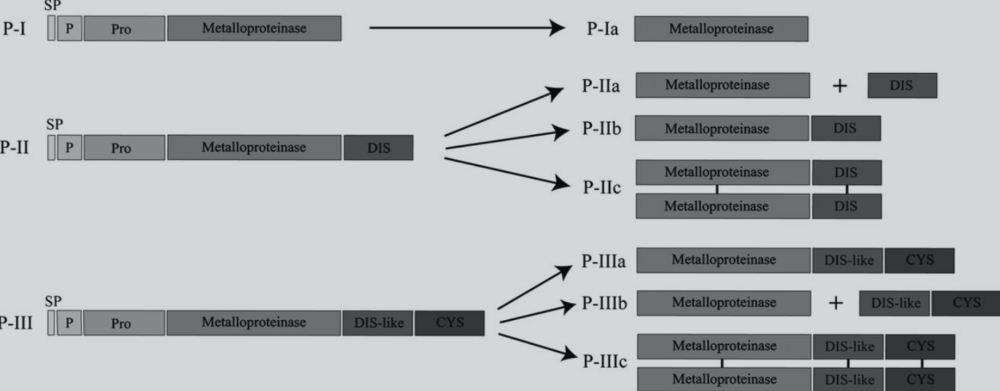

## 10) Toxin gene evolution
In this section, we will use predicted venom toxin genes annotated on our reference genome and perform several different analyses. We will focus on two toxin families that are known to be abundant in the venom protein of G. ussuriensis: snake venom metalloproteases (SVMPs) and phospholipase A2 (PLA2). These are also known to be prominent components of the crotaline venom toxin repertoire more generally.

### SVMP and PLA2 phylogenies
#### Step 1: Validation of predicted proteins
We will start by analyzing the evolutionary histories of SVMPs and PLA2s. In our core toxin annotation (containing 110 curated genomic loci), we have 17 SVMP proteins with genomic loci predicted on chromosome 9, and 5 PLA2 proteins with genomic loci predicted on chromosome 16. 

We will start by validating these predictions. The script below will inspect the toxin CDS FASTA files, SVMP/PLA2 sequence counting, protein length and sequence integrity checks:
```sh
# make sure to activate the funannotate conda env to use python

# ============================================================
# SVMP and PLA2 protein sequence QC
# ============================================================

# 1. set directories and input files
ROOT="$HOME/mendel-nas1/snake_genome_ass/G_ussuriensis_Chromo/annotation/toxin_gene_annotation_RNAdata_added/SRR35908235_ToxCodAn-Genome"

PEP="$ROOT/toxin_annotation_pep.fasta"
CDS="$ROOT/toxin_annotation_cds.fasta"
GTF="$ROOT/toxin_annotation.gtf"

OUTDIR="$ROOT/phylogeny"
mkdir -p "$OUTDIR"

# 2. verify input files
echo "===== INPUT FILES ====="

for file in "$PEP" "$CDS" "$GTF"
do
    if [[ ! -f "$file" ]]; then
        echo "ERROR: Missing file: $file"
        exit 1
    fi
    ls -lh "$file"
done


# 3. inspect protein FASTA headers
echo
echo "===== FIRST 15 FASTA HEADERS ====="
grep '^>' "$PEP" | head -n 15 || true

echo
echo "===== SVMP HEADERS ====="
grep '^>SVMP-' "$PEP" || true

echo
echo "===== PLA2 HEADERS ====="
grep '^>PLA2-' "$PEP" || true


# 4. protein sequence QC and extraction
python - "$PEP" "$OUTDIR" <<'PY'

import sys
import csv
from pathlib import Path
from collections import Counter

pep_file = Path(sys.argv[1])
outdir = Path(sys.argv[2])

families = ("SVMP", "PLA2")

# ------------------------------------------------------------
# Read protein FASTA
# ------------------------------------------------------------

sequences = {}
headers = {}

name = None
parts = []

def save_record():
    if name is not None:
        if name in sequences:
            raise ValueError(f"Duplicate FASTA ID: {name}")
        sequences[name] = "".join(parts).upper()

with pep_file.open() as handle:
    for line in handle:
        line = line.strip()

        if not line:
            continue

        if line.startswith(">"):
            save_record()
            name = line[1:].split()[0]
            headers[name] = line[1:]
            parts = []
        else:
            if name is None:
                raise ValueError("Invalid FASTA format")
            parts.append(line)

    save_record()

print("\n===== TOTAL PROTEIN RECORDS =====")
print(len(sequences))

# ------------------------------------------------------------
# Define preliminary sequence QC criteria
# ------------------------------------------------------------

valid_aa = set("ACDEFGHIKLMNPQRSTVWY")

qc_rows = []

# ------------------------------------------------------------
# Assess and export SVMP and PLA2 proteins
# ------------------------------------------------------------

for family in families:

    selected = {
        gene: seq
        for gene, seq in sequences.items()
        if gene.startswith(family + "-")
    }

    print(f"\n===== {family} PROTEIN QC =====")
    print(f"{'Gene ID':<25} {'Length (aa)':>12}  Status")
    print("-" * 65)

    output_fasta = outdir / f"Guss_{family}_all.faa"

    with output_fasta.open("w") as handle:

        for gene, seq in sorted(selected.items()):

            protein = seq.rstrip("*")

            flags = []

            if not protein:
                flags.append("EMPTY_SEQUENCE")

            if "*" in protein:
                flags.append("INTERNAL_STOP")

            if any(aa not in valid_aa for aa in protein):
                flags.append("NONSTANDARD_AA")

            status = ",".join(flags) if flags else "PASS"

            print(
                f"{gene:<25} "
                f"{len(protein):>12}  "
                f"{status}"
            )

            # Preserve all sequences, including flagged models.
            # Remove only terminal stop symbols for protein FASTA.
            handle.write(f">{gene}\n")

            for i in range(0, len(protein), 80):
                handle.write(protein[i:i+80] + "\n")

            qc_rows.append({
                "gene_id": gene,
                "family": family,
                "length_aa": len(protein),
                "qc_status": status
            })

    print(f"\nTotal {family} proteins: {len(selected)}")
    print(f"FASTA: {output_fasta}")

# ------------------------------------------------------------
# Export QC table
# ------------------------------------------------------------

qc_file = outdir / "Guss_SVMP_PLA2_protein_QC.tsv"

with qc_file.open("w", newline="") as handle:

    writer = csv.DictWriter(
        handle,
        fieldnames=[
            "gene_id",
            "family",
            "length_aa",
            "qc_status"
        ],
        delimiter="\t"
    )

    writer.writeheader()
    writer.writerows(qc_rows)

# ------------------------------------------------------------
# Summarize QC
# ------------------------------------------------------------

print("\n===== QC SUMMARY =====")

for status, count in Counter(
    row["qc_status"] for row in qc_rows
).items():
    print(f"{status}: {count}")

print("\n===== OUTPUT FILES =====")

print(outdir / "Guss_SVMP_all.faa")
print(outdir / "Guss_PLA2_all.faa")
print(qc_file)

print("\npreliminary protein QC completed.")

PY
```
The output will show that there are a total of 120 protein records, 20 of which are SVMPs and 7 are PLA2s. 

During our curation step to generate a "core set" of annotated toxins, we excluded SVMP-6 because it was a redundant annotation with respect to SVMP-5, which had a longer amino acid sequence (487 aa vs. 430 aa of SVMP-6) and had stronger RNA transcript evidence. We further excluded SVMP-16 and SVMP-17 because these were either overlapping or uncertain gene models.  

Regarding PLA2s, we excluded PLA2-1 because a BLASTp run suggested that this is a PLA2 inhibitor-like protein rather than an enzymatic PLA2. In addtion, we excluded PLA2-4 because it contained a premature stop codon in its predicted CDS. 

Thus, this gives us 17 predicted SVMPs and 5 PLA2s to work with. One thing that is notable from our basic predicted protein QC is that the amino acid length is quite variable for SVMPs, ranging from 241aa to 641aa, while PLA2 lengths are more constrained around 118aa-154aa.

Another important thing to keep in mind before moving forward: `PASS` indicates that the amino acid sequence contains no obvious character-level problems. It does not independently establish protein completeness, correct domain architecture, catalytic activity, or venom function.

#### Step 2: Generate curated protein FASTA files
Run the script below to generate curated protein FASTA files that can be used for phylogenetic analyses. The script will generate the two working FASTAs, one for SVMPs and another for PLA2s, validate the expected counts, and identify identical protein sequences. However, it will not collapse identical proteins.
```sh
# ============================================================
# prepare core SVMP and PLA2 protein datasets
# ============================================================
ROOT="$HOME/mendel-nas1/snake_genome_ass/G_ussuriensis_Chromo/annotation/toxin_gene_annotation_RNAdata_added/SRR35908235_ToxCodAn-Genome"

OUTDIR="$ROOT/phylogeny"
export OUTDIR

python - <<'PY'
import os
import csv
from pathlib import Path
from collections import defaultdict

outdir = Path(os.environ["OUTDIR"])

# ----------------------------------------------
# manual curation decisions
# ----------------------------------------------

excluded = {
    "SVMP-6": "Redundant with SVMP-5",
    "PLA2-1": "PLA2 inhibitor-like candidate"
}

noncore = {
    "SVMP-16": "Uncertain gene model",
    "SVMP-17": "Uncertain gene model",
    "PLA2-4": "Internal stop codon"
}

expected = {
    "SVMP": 17,
    "PLA2": 5
}

valid_aa = set("ACDEFGHIKLMNPQRSTVWY")

# ----------------------------------------------
# read FASTA
# ----------------------------------------------

def read_fasta(path):
    records = {}
    name = None
    seq = []

    def save():
        if name is not None:
            if name in records:
                raise ValueError(f"Duplicate ID: {name}")
            records[name] = "".join(seq).upper()

    with path.open() as handle:
        for line in handle:
            line = line.strip()
            if not line:
                continue
            if line.startswith(">"):
                save()
                name = line[1:].split()[0]
                seq = []
            else:
                if name is None:
                    raise ValueError("Invalid FASTA")
                seq.append(line)
        save()

    return records

def write_fasta(path, records):
    with path.open("w") as handle:
        for name, seq in records.items():
            handle.write(f">{name}\n")
            for i in range(0, len(seq), 80):
                handle.write(seq[i:i+80] + "\n")

# ----------------------------------------------
# process protein families
# ----------------------------------------------

manifest = []

for family in ("SVMP", "PLA2"):

    source = outdir / f"Guss_{family}_all.faa"

    if not source.is_file():
        raise FileNotFoundError(source)

    records = read_fasta(source)

    core = {}
    others = {}

    for gene, original_seq in sorted(records.items()):

        seq = original_seq.rstrip("*")

        if gene in excluded:
            status = "EXCLUDED"
            reason = excluded[gene]
        elif gene in noncore:
            status = "NONCORE"
            reason = noncore[gene]
        else:
            status = "CORE"
            reason = "Retained in curated core set"

        if status == "CORE":
            invalid = set(seq) - valid_aa
            if not seq or invalid:
                raise ValueError(
                    f"Core sequence QC failed: {gene}, "
                    f"invalid residues: {sorted(invalid)}"
                )
            core[gene] = seq
        else:
            others[gene] = seq

        manifest.append({
            "gene_id": gene,
            "family": family,
            "length_aa": len(seq),
            "status": status,
            "reason": reason
        })

    if len(core) != expected[family]:
        raise ValueError(
            f"{family}: expected {expected[family]} "
            f"core proteins, found {len(core)}"
        )

    core_file = outdir / f"Guss_{family}_core.faa"
    review_file = outdir / f"Guss_{family}_excluded_review.faa"

    write_fasta(core_file, core)
    write_fasta(review_file, others)

    print(f"\n===== {family} =====")
    print(f"Original predictions: {len(records)}")
    print(f"Core proteins: {len(core)}")
    print(f"Excluded/noncore: {len(others)}")
    print(f"Core FASTA: {core_file}")

    # identify identical protein sequences
    groups = defaultdict(list)

    for gene, seq in core.items():
        groups[seq].append(gene)

    identical = [
        genes for genes in groups.values()
        if len(genes) > 1
    ]

    print("\nIdentical protein groups:")

    if identical:
        for genes in identical:
            print("  " + ", ".join(genes))
    else:
        print("  None")

# ----------------------------------------------
# export curation manifest
# ----------------------------------------------

manifest_file = outdir / "Guss_SVMP_PLA2_curation.tsv"

with manifest_file.open("w", newline="") as handle:
    writer = csv.DictWriter(
        handle,
        fieldnames=[
            "gene_id",
            "family",
            "length_aa",
            "status",
            "reason"
        ],
        delimiter="\t"
    )

    writer.writeheader()
    writer.writerows(manifest)

print("\n===== COMPLETE =====")
print("Curation manifest:", manifest_file)
PY

# ----------------------------------------------
# check available domain annotation software
# ----------------------------------------------

echo
echo "===== DOMAIN ANNOTATION SOFTWARE ====="

for tool in interproscan.sh hmmscan hmmsearch
do
    if command -v "$tool" >/dev/null 2>&1; then
        command -v "$tool"
    else
        echo "$tool: not found in current PATH"
    fi
done
```

The output of this script will show that there are no identical protein pairs among the 17 retained SVMPs, and one identical protein pairs among the 5 retained PLA2s. 

#### Step 3: Protein domain identification using Pfam and HMMER
Here, we will use HMMER and Pfam to annotate the protein domains in our core SVMP and PLA2 sets. Pfam contains models representing conserved protein families and domains. What HMMER basically does is comparing the predicted aa sequences against these Pfam models to identify statistically supported domain matches.  
```sh

# ============================================================
# Pfam domain annotation for SVMP and PLA2
# ============================================================

conda activate funannotate

export FUNANNOTATE_DB="$HOME/mendel-nas1/snake_genome_ass/G_ussuriensis_Chromo/annotation/funannotate_db"

# ------------------------------------------------------------
# 1. directories
# ------------------------------------------------------------

ROOT="$HOME/mendel-nas1/snake_genome_ass/G_ussuriensis_Chromo/annotation/toxin_gene_annotation_RNAdata_added/SRR35908235_ToxCodAn-Genome"

OUTDIR="$ROOT/phylogeny"
mkdir -p "$OUTDIR"

# ------------------------------------------------------------
# 2. locate Pfam database
# ------------------------------------------------------------

echo "===== PFAM DATABASE ====="

echo "FUNANNOTATE_DB: ${FUNANNOTATE_DB:-NOT_SET}"

PFAM="${PFAM_HMM:-}"

if [[ -z "$PFAM" && -n "${FUNANNOTATE_DB:-}" ]]; then
    PFAM="$FUNANNOTATE_DB/Pfam-A.hmm"
fi

if [[ -z "$PFAM" || ! -f "$PFAM" ]]; then
    echo "ERROR: Pfam-A.hmm not found."
    echo "Set PFAM_HMM to the full database path."
    exit 1
fi

echo "Database: $PFAM"

# hmmscan requires a pressed HMM database
for ext in h3f h3i h3m h3p
do
    if [[ ! -f "${PFAM}.${ext}" ]]; then
        echo "ERROR: Missing HMM index: ${PFAM}.${ext}"
        echo "Database needs hmmpress indexing."
        exit 1
    fi
done

# ------------------------------------------------------------
# 3. run hmmscan
# ------------------------------------------------------------

for FAMILY in SVMP PLA2
do
    echo
    echo "===== ${FAMILY} DOMAIN ANNOTATION ====="

    INPUT="$OUTDIR/Guss_${FAMILY}_core.faa"
    DOMTBL="$OUTDIR/Guss_${FAMILY}_Pfam.domtblout"
    REPORT="$OUTDIR/Guss_${FAMILY}_Pfam_report.txt"

    if [[ ! -s "$INPUT" ]]; then
        echo "ERROR: Missing protein FASTA: $INPUT"
        exit 1
    fi

    hmmscan \
        --cpu 2 \
        --cut_ga \
        --noali \
        --domtblout "$DOMTBL" \
        "$PFAM" \
        "$INPUT" \
        > "$REPORT"

    echo "Completed: $FAMILY"
done

# ------------------------------------------------------------
# 4. parse domain annotations
# ------------------------------------------------------------

python - "$OUTDIR" <<'PY'

import sys
import csv
from pathlib import Path
from collections import defaultdict

outdir = Path(sys.argv[1])

families = ("SVMP", "PLA2")

domain_names = {
    "PF01421": "Reprolysin",
    "PF00200": "Disintegrin",
    "PF08516": "ADAM_CR",
    "PF00068": "Phospholip_A2_1"
}

all_hits = []
summary = []

for family in families:

    fasta = outdir / f"Guss_{family}_core.faa"
    domtbl = outdir / f"Guss_{family}_Pfam.domtblout"

    # Read protein IDs and lengths
    proteins = {}
    name = None
    seq = []

    def save():
        if name is not None:
            proteins[name] = len("".join(seq))

    with fasta.open() as handle:
        for line in handle:
            line = line.strip()
            if line.startswith(">"):
                save()
                name = line[1:].split()[0]
                seq = []
            elif line:
                seq.append(line)
        save()

    hits = defaultdict(list)

    # Parse HMMER domtblout
    with domtbl.open() as handle:
        for line in handle:

            if not line.strip() or line.startswith("#"):
                continue

            fields = line.split(maxsplit=22)

            accession = fields[1].split(".")[0]
            gene = fields[3]

            row = {
                "gene_id": gene,
                "family": family,
                "pfam_id": accession,
                "domain": fields[0],
                "ali_start": int(fields[17]),
                "ali_end": int(fields[18]),
                "i_evalue": fields[12],
                "domain_score": fields[13]
            }

            all_hits.append(row)
            hits[gene].append(row)

    print(f"\n===== {family} DOMAIN SUMMARY =====")

    for gene in sorted(proteins):

        gene_hits = hits.get(gene, [])

        descriptions = [
            f"{h['pfam_id']}:{h['domain']}"
            for h in gene_hits
        ]

        domain_string = (
            "; ".join(descriptions)
            if descriptions else "NO_PFAM_HIT"
        )

        print(
            f"{gene:<12} "
            f"{proteins[gene]:>4} aa  "
            f"{domain_string}"
        )

        summary.append({
            "gene_id": gene,
            "family": family,
            "length_aa": proteins[gene],
            "n_domains": len(gene_hits),
            "domains": domain_string
        })

# Export detailed hits
detail_file = outdir / "Guss_SVMP_PLA2_Pfam_domains.tsv"

with detail_file.open("w", newline="") as handle:
    fields = [
        "gene_id", "family", "pfam_id",
        "domain", "ali_start", "ali_end",
        "i_evalue", "domain_score"
    ]
    writer = csv.DictWriter(
        handle, fieldnames=fields, delimiter="\t"
    )
    writer.writeheader()
    writer.writerows(all_hits)

# Export per-protein summary
summary_file = outdir / "Guss_SVMP_PLA2_domain_summary.tsv"

with summary_file.open("w", newline="") as handle:
    fields = [
        "gene_id", "family", "length_aa",
        "n_domains", "domains"
    ]
    writer = csv.DictWriter(
        handle, fieldnames=fields, delimiter="\t"
    )
    writer.writeheader()
    writer.writerows(summary)

print("\n===== OUTPUT FILES =====")
print(detail_file)
print(summary_file)

print("\nDomain annotation completed.")

PY
```
The output of this script will look something like:
```sh
===== SVMP DOMAIN SUMMARY =====
SVMP-1        624 aa  PF01421:Reprolysin; PF08516:ADAM_CR; PF13688:Reprolysin_5; PF00200:Disintegrin; PF01562:Pep_M12B_propep; PF13582:Reprolysin_3; PF13574:Reprolysin_2; PF13583:Reprolysin_4
SVMP-10       482 aa  PF01421:Reprolysin; PF13688:Reprolysin_5; PF01562:Pep_M12B_propep; PF13582:Reprolysin_3; PF00200:Disintegrin; PF13583:Reprolysin_4; PF13574:Reprolysin_2
SVMP-11       611 aa  PF01421:Reprolysin; PF00200:Disintegrin; PF13688:Reprolysin_5; PF08516:ADAM_CR; PF01562:Pep_M12B_propep; PF13582:Reprolysin_3; PF13583:Reprolysin_4; PF13574:Reprolysin_2
SVMP-12       614 aa  PF01421:Reprolysin; PF00200:Disintegrin; PF13688:Reprolysin_5; PF08516:ADAM_CR; PF01562:Pep_M12B_propep; PF13582:Reprolysin_3; PF13583:Reprolysin_4; PF13574:Reprolysin_2
SVMP-13       487 aa  PF01421:Reprolysin; PF13688:Reprolysin_5; PF00200:Disintegrin; PF13582:Reprolysin_3; PF01562:Pep_M12B_propep; PF13583:Reprolysin_4; PF13574:Reprolysin_2
SVMP-14       487 aa  PF01421:Reprolysin; PF13688:Reprolysin_5; PF01562:Pep_M12B_propep; PF13582:Reprolysin_3; PF00200:Disintegrin; PF13583:Reprolysin_4; PF13574:Reprolysin_2
SVMP-15       247 aa  PF01562:Pep_M12B_propep; PF01421:Reprolysin
SVMP-18       603 aa  PF01421:Reprolysin; PF13688:Reprolysin_5; PF00200:Disintegrin; PF01562:Pep_M12B_propep; PF08516:ADAM_CR; PF13582:Reprolysin_3; PF13574:Reprolysin_2; PF13583:Reprolysin_4
SVMP-19       612 aa  PF01421:Reprolysin; PF13688:Reprolysin_5; PF13582:Reprolysin_3; PF08516:ADAM_CR; PF00200:Disintegrin; PF01562:Pep_M12B_propep; PF13574:Reprolysin_2; PF13583:Reprolysin_4
SVMP-2        618 aa  PF01421:Reprolysin; PF13688:Reprolysin_5; PF00200:Disintegrin; PF08516:ADAM_CR; PF01562:Pep_M12B_propep; PF13582:Reprolysin_3; PF13574:Reprolysin_2; PF13583:Reprolysin_4
SVMP-20       612 aa  PF01421:Reprolysin; PF13688:Reprolysin_5; PF00200:Disintegrin; PF13582:Reprolysin_3; PF01562:Pep_M12B_propep; PF08516:ADAM_CR; PF13583:Reprolysin_4; PF13574:Reprolysin_2
SVMP-3        532 aa  PF01421:Reprolysin; PF13688:Reprolysin_5; PF00200:Disintegrin; PF13582:Reprolysin_3; PF01562:Pep_M12B_propep; PF13574:Reprolysin_2; PF13583:Reprolysin_4
SVMP-4        241 aa  PF01562:Pep_M12B_propep
SVMP-5        487 aa  PF01421:Reprolysin; PF13688:Reprolysin_5; PF01562:Pep_M12B_propep; PF00200:Disintegrin; PF13582:Reprolysin_3; PF13583:Reprolysin_4
SVMP-7        476 aa  PF01421:Reprolysin; PF01562:Pep_M12B_propep; PF13688:Reprolysin_5; PF00200:Disintegrin; PF13582:Reprolysin_3; PF13583:Reprolysin_4
SVMP-8        478 aa  PF01421:Reprolysin; PF13688:Reprolysin_5; PF01562:Pep_M12B_propep; PF00200:Disintegrin; PF13582:Reprolysin_3; PF13583:Reprolysin_4; PF13574:Reprolysin_2
SVMP-9        482 aa  PF01421:Reprolysin; PF13688:Reprolysin_5; PF13582:Reprolysin_3; PF01562:Pep_M12B_propep; PF00200:Disintegrin; PF13583:Reprolysin_4; PF13574:Reprolysin_2

===== PLA2 DOMAIN SUMMARY =====
PLA2-2        118 aa  PF00068:Phospholip_A2_1
PLA2-3        140 aa  PF00068:Phospholip_A2_1
PLA2-5        138 aa  PF00068:Phospholip_A2_1
PLA2-6        138 aa  PF00068:Phospholip_A2_1
PLA2-7        138 aa  PF00068:Phospholip_A2_1
```
Regarding SVMPs, SVMP-3, 5, 7, 8, 9, 10, 13, 14 are similar to SVMP P-II class because they possess a propeptide domain, reprolysin/metalloprotease domain, and a disintegrin domain. These SVMPs are 603aa-624aa in length. On the other hand, SVMP-1, 2, 11, 12, 18, 19, 20 can be classified as SVMP P-III class becasue they possess a propeptide domain, reprolysin/metalloprotease domain, disintegrin/DIS-like domain, and a cys-rich domain (ADAM-CR). These SVMPs range in length from 476aa to 532aa. See the below figure from Casewell et al. (2011) for the linear domain structure of SVMPs.
 

SVMP-4 (241aa) and SVMP-15 (247aa) require special attention. First, SVMP-4 only has a propeptide domain and has no significant matches to the canonical metalloprotease domain. SVMP-15 has both domainss but its short length raises the question of whether this metalloprotease domain is complete or truncated.

Regarding PLA2s, all five PLA2s in our curated toxin annotation set had significant Pfam matches to PLA2 family, and have lengths ranging from 118aa to 140aa. Although PLA2-2 is shorter than the rest, this in and of itself is not problematic.

Before extracting protein sequences for phylogenetic analyses, we will run one additional diagnostic step using the HMMER result we already obtained. The below script will check the following:
 - Presence/absence of metalloprotease domain in SVMP-4 and SVMP-15
 - Whether the P-II- and P-III-like proteins have the expected domain order
 - Whether PLA2-2 contains a near-complete PF00068 domain despite its shorter length
```sh
# ============================================================
# inspect SVMP and PLA2 domain coordinates and completeness
# ============================================================

ROOT="$HOME/mendel-nas1/snake_genome_ass/G_ussuriensis_Chromo/annotation/toxin_gene_annotation_RNAdata_added/SRR35908235_ToxCodAn-Genome"

OUTDIR="$ROOT/phylogeny"

python - "$OUTDIR" <<'PY'
import sys
import csv
from pathlib import Path

outdir = Path(sys.argv[1])

target_domains = {
    "PF01421",
    "PF00200",
    "PF08516",
    "PF01562",
    "PF00068"
}

rows = []

for family in ("SVMP", "PLA2"):

    domtbl = outdir / f"Guss_{family}_Pfam.domtblout"

    with domtbl.open() as handle:
        for line in handle:

            if not line.strip() or line.startswith("#"):
                continue

            f = line.split(maxsplit=22)
            pfam = f[1].split(".")[0]

            if pfam not in target_domains:
                continue

            hmm_length = int(f[2])
            hmm_start = int(f[15])
            hmm_end = int(f[16])

            coverage = (
                100 * (hmm_end - hmm_start + 1)
                / hmm_length
            )

            rows.append({
                "family": family,
                "gene_id": f[3],
                "pfam_id": pfam,
                "domain": f[0],
                "aa_start": int(f[17]),
                "aa_end": int(f[18]),
                "hmm_coverage_pct": round(coverage, 1),
                "i_evalue": f[12]
            })

rows.sort(
    key=lambda r: (
        r["family"],
        r["gene_id"],
        r["aa_start"]
    )
)

output = outdir / "Guss_SVMP_PLA2_domain_coordinates.tsv"

with output.open("w", newline="") as handle:
    writer = csv.DictWriter(
        handle,
        fieldnames=list(rows[0]),
        delimiter="\t"
    )
    writer.writeheader()
    writer.writerows(rows)

for family in ("SVMP", "PLA2"):
    print(f"\n===== {family} DOMAIN COORDINATES =====")

    for r in rows:
        if r["family"] != family:
            continue

        print(
            f"{r['gene_id']:<10} "
            f"{r['pfam_id']:<9} "
            f"{r['aa_start']:>4}-"
            f"{r['aa_end']:<4} "
            f"HMM coverage: "
            f"{r['hmm_coverage_pct']:>5.1f}% "
            f"E-value: {r['i_evalue']}"
        )

print("\nOutput:", output)
PY
```
The output will show that SVMP-15 has only 18.5% HMM coverage for the Pfam domain `PF01421`, which is a reprolysin domain. Regarding SVMP-4, there is 100% match to the Pfam domain `PF01562` (reprolysin propeptide). However, there is no reprolysin/metalloprotease domain.

For all five PLA2s, the HMM coverage is > 90% for the Pfam domain `PF00068`, which corresponds to PLA2. PLA2-1 is noteworthy compared to other PLA2s because its domain begins at amino acid 1, whereas the other proteins have approximately 17 residues before the detected domain. This suggests that PLA2-2 may lack the N-terminal signal peptide or that its annotation begins at the mature protein sequence. Alternatively, it could be an incomplete N-terminal prediction. However, its strong Pfam match (E-value 4.4 × 10⁻³²) and 93.6% HMM coverage support its identification as a PLA₂-family protein. We will thus retain all five PLA₂ sequences for our primary analysis, while flagging PLA2-2 for inspection.

#### Step 4: Prepare primary protein sequences
Now, we will prepare primary protein sequences for phylogenetic analyses. For SVMPs, we will extract the metalloprotease domain (`PF01421`) that is conserved across all SVMP classes. Our SVMPs frequently include `PF01421`, `PF13574`, `PF13582`, `PF13583`, and `PF13688` domains. This does not mean that these are five different domains. Instead, these are different Pfam profiles that recognize related metalloproteinase sequences. For example, a single SVMP protein might match multiple Reprolysin HMM profiles. 

For PLA2s, we will initialy retain the full predicted proteins, because strictly extracting `PF00068` would discard some C-terminal residues that may contain useful phylogenetic information. We can account for the apparently missing N-terminal region of PLA2-2 during alignment.

Run the script below:
```sh
# ============================================================
# prepare SVMP and PLA2 sequences for phylogenetic analyses
# ============================================================

# ------------------------------------------------------------
# 1. directories
# ------------------------------------------------------------

ROOT="$HOME/mendel-nas1/snake_genome_ass/G_ussuriensis_Chromo/annotation/toxin_gene_annotation_RNAdata_added/SRR35908235_ToxCodAn-Genome"

OUTDIR="$ROOT/phylogeny"

# ------------------------------------------------------------
# 2. extract phylogenetic sequences
# ------------------------------------------------------------

python - "$OUTDIR" <<'PY'

import sys
import csv
from pathlib import Path

outdir = Path(sys.argv[1])

def read_fasta(path):
    sequences = {}
    name = None
    parts = []

    def save():
        if name is not None:
            if name in sequences:
                raise ValueError(f"Duplicate FASTA ID: {name}")
            sequences[name] = "".join(parts)

    with path.open() as handle:
        for line in handle:
            line = line.strip()
            if not line:
                continue
            if line.startswith(">"):
                save()
                name = line[1:].split()[0]
                parts = []
            else:
                parts.append(line)
        save()

    return sequences

def write_fasta(path, sequences):
    with path.open("w") as handle:
        for gene, seq in sequences.items():
            handle.write(f">{gene}\n")
            for i in range(0, len(seq), 80):
                handle.write(seq[i:i+80] + "\n")

# ------------------------------------------------------------
# 3. extract complete SVMP metalloproteinase domains
# ------------------------------------------------------------

svmp = read_fasta(outdir / "Guss_SVMP_core.faa")

domtbl = outdir / "Guss_SVMP_Pfam.domtblout"

selected = {}
excluded = {}

with domtbl.open() as handle:
    for line in handle:
        if not line.strip() or line.startswith("#"):
            continue

        f = line.split(maxsplit=22)

        pfam = f[1].split(".")[0]
        gene = f[3]

        if pfam != "PF01421":
            continue

        if gene not in svmp:
            raise ValueError(f"Unknown SVMP: {gene}")

        hmm_length = int(f[2])
        hmm_start = int(f[15])
        hmm_end = int(f[16])

        aa_start = int(f[17])
        aa_end = int(f[18])

        coverage = (
            hmm_end - hmm_start + 1
        ) / hmm_length

        if coverage >= 0.90:

            if gene in selected:
                raise ValueError(
                    f"Multiple qualifying domains: {gene}"
                )

            selected[gene] = svmp[gene][
                aa_start - 1:aa_end
            ]

for gene in svmp:
    if gene not in selected:
        excluded[gene] = svmp[gene]

if len(selected) != 15:
    raise ValueError(
        f"Expected 15 SVMP domains, found {len(selected)}"
    )

svmp_file = outdir / "Guss_SVMP_PF01421_primary.faa"

write_fasta(svmp_file, selected)

# ------------------------------------------------------------
# 4. prepare PLA2 proteins
# ------------------------------------------------------------

pla2 = read_fasta(outdir / "Guss_PLA2_core.faa")

if len(pla2) != 5:
    raise ValueError(
        f"Expected 5 PLA2 proteins, found {len(pla2)}"
    )

pla2_file = outdir / "Guss_PLA2_full_primary.faa"

write_fasta(pla2_file, pla2)

# ------------------------------------------------------------
# 5. print summary
# ------------------------------------------------------------

print("\n===== SVMP PRIMARY DATASET =====")

for gene, seq in sorted(selected.items()):
    print(f"{gene:<12} {len(seq):>4} aa")

print("\nExcluded from primary SVMP alignment:")

for gene in sorted(excluded):
    print(gene)

print("\n===== PLA2 PRIMARY DATASET =====")

for gene, seq in sorted(pla2.items()):
    print(f"{gene:<12} {len(seq):>4} aa")

print("\n===== OUTPUT FILES =====")
print(svmp_file)
print(pla2_file)

print("\nsequence preparation for phylogenetic analyses completed.")

PY
```

#### Step 5: Collect homologous sequences from other species

### Toxin gene microsynteny with other venomous snakes
Here, we will explore the organization of SVMPs and PLA2s in different venom snake lineages. We will use our *G. ussuriensis* assembly and chromosome-level genomes of *Crotalus adamanteus*, *Cerastes gasperettii*, and *Naja naja*. For this analysis, we will closely follow the methods used by Mochales-Riaño et al. (2025). As outlined in that study, we will use BLASTn to identify the genomic locations of homologous SVMPs and PLA2s and their nontoxin paralogs/conserved flanking genes. 

These genomes have their respective toxin gene anootation, and we already downloaded these assemblies for chromosomal macrosynteny analysis (see `11_Synteny.md`. I actually ran syteny analysis first, but documentation-wise I tought it would be better placed after these analyses). These assemblies are placed under the following directory:
```sh
/home/yshin/mendel-nas1/snake_genome_ass/G_ussuriensis_Chromo/synteny/assemblies_synteny
```  
We will create the following directory structure:
```sh
synteny/
├── assemblies_synteny/          # existing reference genomes
│
└── toxin_microsynteny/
    ├── 01_reference_inventory/
    ├── 02_blast/
    │   ├── SVMP/
    │   └── PLA2/
    ├── 03_genomic_intervals/
    │   ├── SVMP/
    │   └── PLA2/
    ├── 04_alignments/
    │   ├── SVMP/
    │   └── PLA2/
    ├── 05_annotations/
    └── 06_figures/
```

Use the script below to create this directory stucture:
```sh

# ============================================================
# create SVMP and PLA2 comparative microsynteny directories
# ============================================================

# 1. directories

ROOT="$HOME/mendel-nas1/snake_genome_ass/G_ussuriensis_Chromo"

SYNTENY="$ROOT/synteny/toxin_microsynteny"

# 2. create directories

mkdir -p \
    "$SYNTENY/01_reference_inventory" \
    "$SYNTENY/02_blast/SVMP" \
    "$SYNTENY/02_blast/PLA2" \
    "$SYNTENY/03_genomic_intervals/SVMP" \
    "$SYNTENY/03_genomic_intervals/PLA2" \
    "$SYNTENY/04_alignments/SVMP" \
    "$SYNTENY/04_alignments/PLA2" \
    "$SYNTENY/05_annotations" \
    "$SYNTENY/06_figures"

# 3. verify directory structure

echo "===== MICROSYNTENY DIRECTORY STRUCTURE ====="

find "$SYNTENY" -type d | sort

echo
echo "===== COMPLETE ====="
```

#### Step 1: Locate the files needed
First, let's identify the actual FASTA files, assembly versions, and available GFF3/GTF annotations. Below is a read-only script that will do the job. This will not create any new folders or files.
```sh
# ============================================================
# inspect reference genomes and annotations
# ============================================================

# 1. directories
ROOT="$HOME/mendel-nas1/snake_genome_ass/G_ussuriensis_Chromo"
ASSEMBLIES="$ROOT/synteny/assemblies_synteny"

# 2. inspect reference species
for SPECIES in \
    Cerastes_gasperettii \
    Crotalus_adamanteus \
    Naja_naja
do
    echo
    echo "============================================================"
    echo "$SPECIES"
    echo "============================================================"

    DIR="$ASSEMBLIES/$SPECIES"

    if [[ ! -d "$DIR" ]]; then
        echo "ERROR: Species directory missing."
        continue
    fi

    echo
    echo "===== DIRECTORY CONTENTS ====="

    ls -lah "$DIR"

    echo
    echo "===== GENOME AND ANNOTATION FILES ====="

    find "$DIR" -maxdepth 4 -type f \
        \( -iname '*.fa' \
        -o -iname '*.fasta' \
        -o -iname '*.fna' \
        -o -iname '*.fa.gz' \
        -o -iname '*.fasta.gz' \
        -o -iname '*.fna.gz' \
        -o -iname '*.gff' \
        -o -iname '*.gff3' \
        -o -iname '*.gtf' \
        -o -iname '*.gff.gz' \
        -o -iname '*.gff3.gz' \
        -o -iname '*.gtf.gz' \
        -o -iname '*.faa' \
        -o -iname '*.faa.gz' \
        -o -iname '*.gbff' \
        -o -iname '*.gbff.gz' \) \
        -print | sort

done

# 3. inspect existing assembly inventories
echo
echo "===== ASSEMBLY MANIFEST ====="

head -n 12 "$ASSEMBLIES/assembly_manifest.tsv"

echo
echo "===== ANNOTATION INVENTORY ====="

head -n 12 "$ASSEMBLIES/annotation_protein_inventory.tsv"


# 4. inspect G. ussuriensis toxin annotation
echo
echo "===== G. USSURIENSIS TOXIN ANNOTATION ====="

TOXIN="$ROOT/annotation/toxin_gene_annotation_RNAdata_added/SRR35908235_ToxCodAn-Genome"

ls -lh \
    "$TOXIN/toxin_annotation.gtf" \
    "$TOXIN/toxin_annotation_cds.fasta" \
    "$TOXIN/toxin_annotation_pep.fasta"

echo
echo "===== COMPLETE ====="
```
The output of this script will show that our three comparison taxa all have the genome FASTA, gneome annotation GFF3, and protein FASTA files. It will also show that we have (as expected) *G. ussuriensis* ToxCodAn GTF, CDS FASTA, and protein FASTA.

#### Step 2: Extract genomic coordinates of *G. ussuriensis* SVMPs and PLA2s
This step will establish the focal genomic regions against which we will compare the other three species. Unlike the phylogenetic analysis, microsynteny should include our complete locus inventory, including SVMP-4, SVMP-15, and PLA2-4 where their genomic positions are supported.
```sh
# ============================================================
# inspect G. ussuriensis SVMP and PLA2 gene coordinates
# ============================================================

# activate funannotate conda env to access python
conda activate funannotate

# 1. directories
ROOT="$HOME/mendel-nas1/snake_genome_ass/G_ussuriensis_Chromo"
TOXIN="$ROOT/annotation/toxin_gene_annotation_RNAdata_added/SRR35908235_ToxCodAn-Genome"
GTF="$TOXIN/toxin_annotation.gtf"

# 2. inspect GTF structure
echo "===== GTF STRUCTURE ====="

grep -v '^#' "$GTF" | head -n 5

echo
echo "===== FEATURE TYPES ====="

awk -F '\t' '
    $0 !~ /^#/ && NF >= 9 {
        count[$3]++
    }
    END {
        for (feature in count)
            print feature, count[feature]
    }
' "$GTF" | sort

# 3. extract SVMP and PLA2 gene coordinates
echo
echo "===== TOXIN GENE COORDINATES ====="

python - "$GTF" <<'PY'

import sys
import re
from collections import defaultdict

gtf = sys.argv[1]

loci = defaultdict(
    lambda: {
        "chr": set(),
        "start": float("inf"),
        "end": 0,
        "features": set()
    }
)

with open(gtf) as handle:

    for line in handle:

        if not line.strip() or line.startswith("#"):
            continue

        fields = line.rstrip("\n").split("\t")

        if len(fields) < 9:
            continue

        chrom = fields[0]
        feature = fields[2]
        start = int(fields[3])
        end = int(fields[4])
        attributes = fields[8]

        match = re.search(
            r'(?:SVMP|PLA2)-\d+',
            attributes
        )

        if not match:
            continue

        gene = match.group(0)

        loci[gene]["chr"].add(chrom)
        loci[gene]["start"] = min(
            loci[gene]["start"], start
        )
        loci[gene]["end"] = max(
            loci[gene]["end"], end
        )
        loci[gene]["features"].add(feature)

def sort_key(gene):
    family, number = gene.split("-")
    return (family, int(number))

print(
    f"{'Gene':<12}"
    f"{'Chromosome':<24}"
    f"{'Start':>14}"
    f"{'End':>14}"
    f"{'Span (bp)':>14}"
)

for gene in sorted(loci, key=sort_key):

    row = loci[gene]

    span = row["end"] - row["start"] + 1

    print(
        f"{gene:<12}"
        f"{','.join(sorted(row['chr'])):<24}"
        f"{row['start']:>14,}"
        f"{row['end']:>14,}"
        f"{span:>14,}"
    )

print()
print("Total loci:", len(loci))

print(
    "SVMP loci:",
    sum(g.startswith("SVMP-") for g in loci)
)

print(
    "PLA2 loci:",
    sum(g.startswith("PLA2-") for g in loci)
)

if not loci:
    print(
        "WARNING: No matching gene IDs found. "
        "Inspect the GTF attributes shown above."
    )

PY

# 4. locate G. ussuriensis reference assembly
echo
echo "===== G. USSURIENSIS ASSEMBLY CANDIDATES ====="

find "$ROOT" -maxdepth 6 \
    \( -type f -o -type l \) \
    \( -name '*.fai' \
       -o -name '*genome*.fasta' \
       -o -name '*genome*.fa' \
       -o -name '*assembly*.fasta' \
       -o -name '*assembly*.fa' \) \
    -not -path '*/assemblies_synteny/*' \
    -print 2>/dev/null | head -n 40

echo
echo "===== COMPLETE ====="
```
The coordinate extraction output will tell us that within our G. ussuriensis assembly, 20 SVMPs spanning 747.2 kb are clustered on chromosome 9 (genomic intervals 5,375,758 bp - 6,122,976 bp) and 6 PLA2s spanning 34.5 kb (genomic intervals 278,191 bp - 312,734bp) are clustered on chromosome 16. A seventh PLA₂-labeled model, PLA2-1, is located separately on chromosome 10. However, recall that we reclassified this loci as PLA2 inhibitor-like protein rather than enzymatic PLA2 (see `09_ToxinAnnotationEval.md`).

Also, recall some important considerations from our toxin curation step. The 20 SVMP predictions should not be interpreted as 20 independently supported functional genes. In our previous curation, SVMP-5 and SVMP-6 represented overlapping alternative candidates, with SVMP-5 retained. SVMP-16 and SVMP-17 also have overlapping genomic coordinates and we flagged these as being uncertain gene models. Likewise, the PLA₂ array contains PLA2-4, which had a problematic gene model, and PLA2-5 and PLA2-6, which are distinct tandem loci despite encoding identical proteins.

#### Step 3: Verify the reference assembly and prepare genomic intervals
For this analysis, we will use unmasked genome (i.e. input FASTA we gave to Earl Grey). Recall that this genome is located in:
```sh
/home/yshin/mendel-nas1/snake_genome_ass/G_ussuriensis_Chromo/final_assembly/curated/Gloydius_ussuriensis_AMNH_21010_curated_scaffold11_split.fa
```

We will use the previously identified toxin clusters and initially include 250 kb of flanking sequence on each side. So for SVMPs and PLA2s, this becomes:
 - SVMPs: Chromosome 9. Genomic interval including the flanking sequences = 5,125,758–6,372,976 bp. Total length = 1,247,219 bp
 - PLA2s: Chromosome 16. Genomic interval including the flanking sequences = 28,191–562,734 bp. Total length = 534,544 bp

Use the script below will extract these genomic intervals from our *G. ussuriensis* reference genome.
```sh
# ============================================================
# extract G. ussuriensis SVMP and PLA2 genomic intervals
# ============================================================

# 1. directories
ROOT="$HOME/mendel-nas1/snake_genome_ass/G_ussuriensis_Chromo"
GENOME="$ROOT/final_assembly/curated/Gloydius_ussuriensis_AMNH_21010_curated_scaffold11_split.fa"
OUTDIR="$ROOT/synteny/toxin_microsynteny/03_genomic_intervals/Gloydius_ussuriensis"

mkdir -p "$OUTDIR"

# 2. verify reference genome
echo "===== REFERENCE GENOME ====="

for FILE in "$GENOME" "${GENOME}.fai"
do
    if [[ ! -s "$FILE" ]]; then
        echo "ERROR: Missing $FILE"
        return 1 2>/dev/null || exit 1
    fi
done

command -v samtools

# 3. extract genomic intervals
echo
echo "===== EXTRACT SVMP REGION ====="

samtools faidx \
    "$GENOME" \
    "G_ussuri_chr9:5125758-6372976" \
    > "$OUTDIR/Guss_SVMP_region.fa"

echo
echo "===== EXTRACT PLA2 REGION ====="

samtools faidx \
    "$GENOME" \
    "G_ussuri_chr16:28191-562734" \
    > "$OUTDIR/Guss_PLA2_region.fa"

# 4. verify extracted sequences
echo
echo "===== EXTRACTED SEQUENCES ====="

for FILE in \
    "$OUTDIR/Guss_SVMP_region.fa" \
    "$OUTDIR/Guss_PLA2_region.fa"
do
    echo
    echo "$FILE"

    if [[ ! -s "$FILE" ]]; then
        echo "ERROR: Missing or empty output"
        continue
    fi

    head -n 1 "$FILE"

    awk '
        !/^>/ {
            total += length($0)
        }
        END {
            print "Sequence length:", total, "bp"
        }
    ' "$FILE"
done

# 5. locate genome gene annotations
echo
echo "===== G. USSURIENSIS GENE ANNOTATIONS ====="

find "$ROOT/annotation/funannotate" -maxdepth 5 -type f \
    \( -name '*.gff3' -o -name '*.gff' -o -name '*.gtf' \) \
    -print 2>/dev/null | head -n 30

echo
echo "===== COMPLETE ====="
```
This script will put the genomic region .fa file under the directory `/home/yshin/mendel-nas1/snake_genome_ass/G_ussuriensis_Chromo/synteny/toxin_microsynteny/03_genomic_intervals/Gloydius_ussuriensis`. The filenames will appear as `Guss_SVMP_region.fa` and `Guss_PLA2_region.fa`. Our directory structure has a separate folder for each gene family. We will thus move these files to their respective directory:
```sh
# ============================================================
# organize SVMP and PLA2 genomic interval files
# ============================================================

# 1. directories
ROOT="$HOME/mendel-nas1/snake_genome_ass/G_ussuriensis_Chromo"
SYNTENY="$ROOT/synteny/toxin_microsynteny"
SOURCE="$SYNTENY/03_genomic_intervals/Gloydius_ussuriensis"

# 2. organize genomic intervals
for FAMILY in SVMP PLA2
do
    SRC="$SOURCE/Guss_${FAMILY}_region.fa"
    DEST="$SYNTENY/03_genomic_intervals/$FAMILY/Guss_${FAMILY}_region.fa"

    mkdir -p "$(dirname "$DEST")"

    if [[ -s "$SRC" && ! -e "$DEST" ]]; then
        mv "$SRC" "$DEST"
    elif [[ -s "$DEST" ]]; then
        echo "Destination already exists: $DEST"
    else
        echo "WARNING: Missing genomic interval for $FAMILY"
    fi
done

# 3. verify files
echo "===== GENOMIC INTERVALS ====="

find "$SYNTENY/03_genomic_intervals" \
    -type f -name '*.fa' -print | sort
```

Before moving on to BLASTn, let's identify the flanking genes around the toxin clusters to establish that we're comparing homologous chromosomal neighborhoods, not merely regions containing similar toxin genes. For this, we will use our Funannotate annotation to identify conserved genes surrounding the *G. ussuriensis* SVMP and PLA₂ arrays.

We should first confirm that the GFF3 contains gene features on the expected chromosomes.
```sh
# ============================================================
# inspect Funannotate genes in SVMP and PLA2 regions
# ============================================================

# 1. directories
ROOT="$HOME/mendel-nas1/snake_genome_ass/G_ussuriensis_Chromo"
GFF="$ROOT/annotation/funannotate/update_results/Gloydius_ussuriensis_AMNH_21010.gff3"

# 2. inspect annotation
echo "===== FUNANNOTATE ANNOTATION ====="

ls -lh "$GFF"

echo
echo "===== EXAMPLE GENE RECORDS ====="

awk -F '\t' '
    $0 !~ /^#/ && $3 == "gene" {
        print
        if (++n == 5) exit
    }
' "$GFF"

# 3. inspect genes around toxin clusters
python - "$GFF" <<'PY'

import sys
from collections import Counter

gff = sys.argv[1]

regions = {
    "SVMP": ("G_ussuri_chr9", 5125758, 6372976),
    "PLA2": ("G_ussuri_chr16", 28191, 562734)
}

for family, (chrom, start, end) in regions.items():

    genes = []
    features = Counter()

    with open(gff) as handle:
        for line in handle:

            if not line.strip() or line.startswith("#"):
                continue

            f = line.rstrip("\n").split("\t")

            if len(f) < 9 or f[0] != chrom:
                continue

            a = int(f[3])
            b = int(f[4])

            if a > end or b < start:
                continue

            features[f[2]] += 1

            if f[2] == "gene":
                genes.append((a, b, f[6], f[8]))

    genes.sort()

    print(f"\n===== {family} REGION =====")

    print(f"Chromosome: {chrom}")
    print(f"Interval: {start:,}-{end:,}")
    print(f"Annotated genes: {len(genes)}")
    print(f"Feature types: {dict(features)}")

    print("\nFirst 5 genes:")

    for gene in genes[:5]:
        print(*gene, sep="\t")

    print("\nLast 5 genes:")

    for gene in genes[-5:]:
        print(*gene, sep="\t")

print("\n===== COMPLETE =====")
PY
```

The results should confirm that our Funannotate GFF3 contains gene models surrounding both toxin clusters. Now, we will move on to identifying what these gene models are. The script below will handle this task and create `05_annotations/Guss_SVMP_PLA2_flanking_genes.tsv` as an output.
```sh
# ============================================================
# identify SVMP and PLA2 flanking genes
# ============================================================

# 1. directories
ROOT="$HOME/mendel-nas1/snake_genome_ass/G_ussuriensis_Chromo"
GFF="$ROOT/annotation/funannotate/update_results/Gloydius_ussuriensis_AMNH_21010.gff3"
OUTDIR="$ROOT/synteny/toxin_microsynteny/05_annotations"

mkdir -p "$OUTDIR"

# 2. extract Funannotate gene annotations
python - "$GFF" "$OUTDIR" <<'PY'

import sys
import csv
from pathlib import Path
from urllib.parse import unquote
from collections import defaultdict

gff = Path(sys.argv[1])
outdir = Path(sys.argv[2])

regions = {
    "SVMP": {
        "chr": "G_ussuri_chr9",
        "region_start": 5125758,
        "region_end": 6372976,
        "cluster_start": 5375758,
        "cluster_end": 6122976
    },
    "PLA2": {
        "chr": "G_ussuri_chr16",
        "region_start": 28191,
        "region_end": 562734,
        "cluster_start": 278191,
        "cluster_end": 312734
    }
}

def parse_attributes(text):
    result = {}
    for part in text.strip().split(";"):
        if "=" in part:
            key, value = part.split("=", 1)
            result[key] = unquote(value)
    return result

genes = {}
transcripts = defaultdict(list)

with gff.open() as handle:
    for line in handle:

        if not line.strip() or line.startswith("#"):
            continue

        f = line.rstrip("\n").split("\t")

        if len(f) < 9:
            continue

        if f[2] not in ("gene", "mRNA"):
            continue

        attr = parse_attributes(f[8])

        if f[2] == "gene":

            gene_id = attr.get("ID")

            if not gene_id:
                continue

            genes[gene_id] = {
                "chr": f[0],
                "start": int(f[3]),
                "end": int(f[4]),
                "strand": f[6],
                "gene_name": attr.get("Name", ""),
                "product": attr.get("product", ""),
                "note": attr.get("Note", "")
            }

        elif f[2] == "mRNA":

            for parent in attr.get("Parent", "").split(","):
                if parent:
                    transcripts[parent].append(attr)

# Recover functional descriptions from transcripts
for gene_id, gene in genes.items():

    for tx in transcripts.get(gene_id, []):

        if not gene["product"]:
            gene["product"] = tx.get("product", "")

        if not gene["note"]:
            gene["note"] = tx.get("Note", "")

# 3. classify genes relative to toxin clusters

rows = []

for family, r in regions.items():

    for gene_id, gene in genes.items():

        if gene["chr"] != r["chr"]:
            continue

        start = gene["start"]
        end = gene["end"]

        if (
            end < r["region_start"]
            or start > r["region_end"]
        ):
            continue

        if end < r["cluster_start"]:
            position = "left_flank"
            distance = r["cluster_start"] - end

        elif start > r["cluster_end"]:
            position = "right_flank"
            distance = start - r["cluster_end"]

        else:
            position = "cluster_overlap"
            distance = 0

        rows.append({
            "family": family,
            "gene_id": gene_id,
            "chr": gene["chr"],
            "start": start,
            "end": end,
            "strand": gene["strand"],
            "position": position,
            "distance_bp": distance,
            "gene_name": gene["gene_name"],
            "product": gene["product"],
            "note": gene["note"]
        })

rows.sort(
    key=lambda x: (
        x["family"],
        x["start"]
    )
)

# 4. export annotation table

output = outdir / "Guss_SVMP_PLA2_flanking_genes.tsv"

with output.open("w", newline="") as handle:

    writer = csv.DictWriter(
        handle,
        fieldnames=[
            "family",
            "gene_id",
            "chr",
            "start",
            "end",
            "strand",
            "position",
            "distance_bp",
            "gene_name",
            "product",
            "note"
        ],
        delimiter="\t"
    )

    writer.writeheader()
    writer.writerows(rows)

# 5. print closest flanking genes

for family in ("SVMP", "PLA2"):

    print(f"\n===== {family} REGION =====")

    subset = [
        r for r in rows
        if r["family"] == family
    ]

    for side in ("left_flank", "right_flank"):

        flank = sorted(
            [r for r in subset if r["position"] == side],
            key=lambda x: x["distance_bp"]
        )

        print(f"\n===== {side.upper()} =====")

        if not flank:
            print("No genes identified in working interval.")

        for r in flank[:8]:

            description = (
                r["product"]
                or r["gene_name"]
                or r["note"]
                or "UNANNOTATED"
            )

            print(
                f"{r['gene_id']:<14}"
                f"{r['start']:>10,}-"
                f"{r['end']:<10,} "
                f"{r['strand']} "
                f"{r['distance_bp']:>9,} bp  "
                f"{description[:90]}"
            )

    print(
        "\nFunannotate genes overlapping cluster:",
        sum(r["position"] == "cluster_overlap" for r in subset)
    )

print("\n===== OUTPUT FILE =====")
print(output)

PY
```
The output should indicate that we have successfully identified candidate flanking genes around both *G. ussuriensis* toxin clusters, but their functional identities remain unresolved (flanking genes marked as either `hypothetical protein` or `UNANNOTATED`). Therefore, the next step is to identify their homologs in *Cerastes gasperettii*, *Crotalus adamanteus*, and *Naja naja*. Because we already have annotated proteomes for these three comparative species, we will protein homology searches to establish conserved flanking genes.
```sh
# ============================================================
# identify protein sequences for SVMP and PLA2 flanking genes
# ============================================================

# 1. directories
ROOT="$HOME/mendel-nas1/snake_genome_ass/G_ussuriensis_Chromo"
ANNOTATION="$ROOT/annotation/funannotate"

# 2. locate protein FASTA files
echo "===== FUNANNOTATE PROTEIN FILES ====="

find "$ANNOTATION" -maxdepth 4 -type f \
    \( -iname '*proteins*.fa' \
       -o -iname '*proteins*.fasta' \
       -o -iname '*proteins*.faa' \) \
    -print | sort

# 3. inspect protein FASTA headers

echo
echo "===== PROTEIN FASTA HEADERS ====="

for FILE in \
    "$ANNOTATION/update_results/"*proteins* \
    "$ANNOTATION/annotate_results/"*proteins*
do
    if [[ ! -f "$FILE" ]]; then
        continue
    fi

    echo
    echo "FILE: $FILE"

    grep -m 5 '^>' "$FILE" || true
done

# 4. search candidate flanking genes
echo
echo "===== FLANKING GENE PROTEIN IDS ====="

for FILE in \
    "$ANNOTATION/update_results/"*proteins* \
    "$ANNOTATION/annotate_results/"*proteins*
do
    if [[ ! -f "$FILE" ]]; then
        continue
    fi

    echo
    echo "FILE: $FILE"

    grep '^>' "$FILE" |
        grep -E \
        'FUN_01451[123]|FUN_01452[67]|FUN_01805[78]|FUN_01807[23]' \
        || true
done

# 5. check homology search software
echo
echo "===== HOMOLOGY SEARCH SOFTWARE ====="

for TOOL in blastp makeblastdb blastn seqkit gffread
do
    if command -v "$TOOL" >/dev/null 2>&1; then
        echo "$TOOL: $(command -v "$TOOL")"
    else
        echo "$TOOL: NOT_FOUND"
    fi
done

echo
echo "===== COMPLETE ====="
```
The output of this script will verify that we have the Funannotate protein sequences needed for our flanking-gene analysis, and that all the necessary BLAST tools are installed. We will use the protein sequences from `annotation/funannotate/update_results/Gloydius_ussuriensis_AMNH_21010.proteins.fa`.

#### Step 4: BLASTp of flanking genes
Our immediate objective now is to identify candidate homologs of the *G. ussuriensis* flanking genes in the three comparison taxa.

The approach will be:
 1. Extract proteins corresponding to the closest eight annotated genes on each side of each toxin cluster, where available.
 2. Build BLAST databases from the existing comparative proteomes.
 3. Run BLASTp separately for SVMP and PLA₂ flanking-gene sets.
 4. Record the top 20 matches per query for subsequent orthology assessment.

 The script below will do the job:
 ```sh
 #!/bin/bash
#SBATCH --job-name=toxin_flank_blastp
#SBATCH --nodes=1
#SBATCH --ntasks=1
#SBATCH --cpus-per-task=4
#SBATCH --mem=16G
#SBATCH --time=04:00:00
#SBATCH --partition=compute
#SBATCH --mail-type=ALL
#SBATCH --mail-user=yshin@amnh.org
#SBATCH --output=/home/yshin/mendel-nas1/snake_genome_ass/G_ussuriensis_Chromo/scripts/outfiles/slurm-%x_%j.out
#SBATCH --error=/home/yshin/mendel-nas1/snake_genome_ass/G_ussuriensis_Chromo/scripts/outfiles/slurm-%x_%j.err

# ============================================================
# activate environment
# ============================================================
source "$HOME/mendel-nas1/miniconda3/etc/profile.d/conda.sh"
conda activate funannotate

# ============================================================
# run blastp to identify SVMP and PLA2 flanking gene homologs
# ============================================================

# activate conda environment
source ~/.bash_profile
conda activate funannotate

set -euo pipefail

# 1. directories
ROOT="$HOME/mendel-nas1/snake_genome_ass/G_ussuriensis_Chromo"
SYNTENY="$ROOT/synteny/toxin_microsynteny"
ASSEMBLIES="$ROOT/synteny/assemblies_synteny"
ANNOTATION="$ROOT/annotation/funannotate/update_results"
PROTEINS="$ANNOTATION/Gloydius_ussuriensis_AMNH_21010.proteins.fa"
FLANKING="$SYNTENY/05_annotations/Guss_SVMP_PLA2_flanking_genes.tsv"
BLASTDIR="$SYNTENY/02_blast"

mkdir -p "$BLASTDIR/SVMP" "$BLASTDIR/PLA2"

# 2. verify input files
echo "===== VERIFY INPUTS ====="
for FILE in "$PROTEINS" "$FLANKING"
do
    if [[ ! -s "$FILE" ]]; then
        echo "ERROR: Missing input: $FILE"
        exit 1
    fi
    echo "OK: $FILE"
done

for TOOL in python blastp makeblastdb
do
    command -v "$TOOL"
done

# 3. extract flanking gene proteins
echo
echo "===== EXTRACT FLANKING PROTEINS ====="

python - "$PROTEINS" "$FLANKING" "$BLASTDIR" <<'PY'

import sys
import csv
import re
from pathlib import Path
from collections import defaultdict

proteins_file = Path(sys.argv[1])
flanking_file = Path(sys.argv[2])
outdir = Path(sys.argv[3])

# Read protein FASTA
proteins = defaultdict(list)

header = None
seq = []

def save():
    if header is None:
        return

    parts = header.split()
    transcript = parts[0]

    gene = (
        parts[1]
        if len(parts) > 1
        else re.sub(r"-T\d+$", "", transcript)
    )

    proteins[gene].append(
        (transcript, "".join(seq))
    )

with proteins_file.open() as handle:
    for line in handle:
        line = line.strip()

        if line.startswith(">"):
            save()
            header = line[1:]
            seq = []
        elif line:
            seq.append(line)

    save()

# Read flanking-gene inventory
with flanking_file.open() as handle:
    rows = list(
        csv.DictReader(handle, delimiter="\t")
    )

for family in ("SVMP", "PLA2"):

    selected = []

    for side in ("left_flank", "right_flank"):

        subset = [
            row for row in rows
            if row["family"] == family
            and row["position"] == side
        ]

        subset.sort(
            key=lambda x: int(x["distance_bp"])
        )

        selected.extend(subset[:8])

    fasta_out = (
        outdir / family /
        f"Guss_{family}_flanking_proteins.faa"
    )

    manifest_out = (
        outdir / family /
        f"Guss_{family}_query_manifest.tsv"
    )

    manifest = []

    with fasta_out.open("w") as fasta:

        for row in selected:

            gene = row["gene_id"]

            candidates = proteins.get(gene, [])

            if not candidates:
                print(
                    f"WARNING: No protein found for {gene}"
                )
                continue

            # Prefer T1 when available.
            t1 = [
                x for x in candidates
                if x[0] == f"{gene}-T1"
            ]

            if t1:
                transcript, sequence = t1[0]
            else:
                transcript, sequence = max(
                    candidates,
                    key=lambda x: len(x[1])
                )

            if not sequence:
                print(
                    f"WARNING: Empty protein for {gene}"
                )
                continue

            fasta.write(f">{transcript} {gene}\n")

            for i in range(0, len(sequence), 80):
                fasta.write(sequence[i:i+80] + "\n")

            manifest.append({
                "gene_id": gene,
                "transcript_id": transcript,
                "position": row["position"],
                "distance_bp": row["distance_bp"],
                "length_aa": len(sequence)
            })

    with manifest_out.open("w", newline="") as handle:

        fields = [
            "gene_id",
            "transcript_id",
            "position",
            "distance_bp",
            "length_aa"
        ]

        writer = csv.DictWriter(
            handle,
            fieldnames=fields,
            delimiter="\t"
        )

        writer.writeheader()
        writer.writerows(manifest)

    if not manifest:
        raise ValueError(
            f"No proteins recovered for {family}"
        )

    print(f"\n===== {family} =====")

    for row in manifest:
        print(
            f"{row['transcript_id']:<20}"
            f"{row['length_aa']:>5} aa  "
            f"{row['position']}"
        )

    print(f"\nTotal proteins: {len(manifest)}")
    print(f"FASTA: {fasta_out}")
    print(f"Manifest: {manifest_out}")

PY

# 4. prepare comparative protein BLAST databases
echo
echo "===== PREPARE BLAST DATABASES ====="

for SPECIES in \
    Cerastes_gasperettii \
    Crotalus_adamanteus \
    Naja_naja
do
    PROTEOME="$ASSEMBLIES/$SPECIES/${SPECIES}.protein.faa"

    DB="$BLASTDIR/${SPECIES}_proteins_db"

    if [[ ! -s "$PROTEOME" ]]; then
        echo "ERROR: Missing proteome: $PROTEOME"
        exit 1
    fi

    echo
    echo "Species: $SPECIES"

    if [[ ! -s "${DB}.pin" && ! -s "${DB}.pdb" ]]; then

        makeblastdb \
            -in "$PROTEOME" \
            -dbtype prot \
            -out "$DB"

    else
        echo "Existing BLAST database found."
    fi
done

# 5. run comparative BLASTP
echo
echo "===== RUN BLASTP ====="

for FAMILY in SVMP PLA2
do
    QUERY="$BLASTDIR/$FAMILY/Guss_${FAMILY}_flanking_proteins.faa"

    for SPECIES in \
        Cerastes_gasperettii \
        Crotalus_adamanteus \
        Naja_naja
    do
        DB="$BLASTDIR/${SPECIES}_proteins_db"

        OUTPUT="$BLASTDIR/$FAMILY/Guss_${FAMILY}_vs_${SPECIES}.blastp.tsv"

        echo
        echo "$FAMILY vs $SPECIES"

        blastp \
            -query "$QUERY" \
            -db "$DB" \
            -evalue 1e-5 \
            -max_target_seqs 20 \
            -num_threads 2 \
            -outfmt '6 qseqid sseqid pident length qlen slen qcovs evalue bitscore' \
            -out "$OUTPUT"

        echo "Output: $OUTPUT"
    done
done

# 6. summarize best BLASTP hits
echo
echo "===== BEST BLASTP HITS ====="

python - "$BLASTDIR" <<'PY'
import sys
import csv
from pathlib import Path
from collections import defaultdict

blastdir = Path(sys.argv[1])

species_list = (
    "Cerastes_gasperettii",
    "Crotalus_adamanteus",
    "Naja_naja"
)

for family in ("SVMP", "PLA2"):

    print(f"\n===== {family} =====")

    for species in species_list:

        path = (
            blastdir / family /
            f"Guss_{family}_vs_{species}.blastp.tsv"
        )

        hits = defaultdict(list)

        with path.open() as handle:
            reader = csv.reader(handle, delimiter="\t")

            for row in reader:
                if len(row) < 9:
                    continue

                hits[row[0]].append(row)

        print(f"\n--- {species} ---")

        if not hits:
            print("No hits passing the search threshold.")
            continue

        for query in sorted(hits):

            best = max(
                hits[query],
                key=lambda x: float(x[8])
            )

            print(
                f"{query:<20} "
                f"{best[1]:<28} "
                f"ID={float(best[2]):5.1f}% "
                f"Qcov={float(best[6]):5.1f}% "
                f"E={best[7]}"
            )

print("\n===== COMPLETE =====")
PY
```

Once this finishes running (it will take less than a minute on Mendel), summarize the output:
```sh
# ============================================================
# summarize SVMP and PLA2 flanking gene BLASTp results
# ============================================================

# 1. directories
ROOT="$HOME/mendel-nas1/snake_genome_ass/G_ussuriensis_Chromo"
BLASTDIR="$ROOT/synteny/toxin_microsynteny/02_blast"

# 2. verify BLASTp output files
echo "===== BLASTP OUTPUT FILES ====="

for FAMILY in SVMP PLA2
do
    for SPECIES in \
        Cerastes_gasperettii \
        Crotalus_adamanteus \
        Naja_naja
    do
        FILE="$BLASTDIR/$FAMILY/Guss_${FAMILY}_vs_${SPECIES}.blastp.tsv"

        if [[ -s "$FILE" ]]; then
            echo "OK: $FAMILY vs $SPECIES ($(wc -l < "$FILE") hits)"
        elif [[ -f "$FILE" ]]; then
            echo "EMPTY: $FAMILY vs $SPECIES"
        else
            echo "MISSING: $FAMILY vs $SPECIES"
        fi
    done
done

# 3. summarize best BLASTP hits
for FAMILY in SVMP PLA2
do
    echo
    echo "===== $FAMILY BEST BLASTP HITS ====="

    for SPECIES in \
        Cerastes_gasperettii \
        Crotalus_adamanteus \
        Naja_naja
    do
        FILE="$BLASTDIR/$FAMILY/Guss_${FAMILY}_vs_${SPECIES}.blastp.tsv"

        echo
        echo "----- $SPECIES -----"

        if [[ ! -s "$FILE" ]]; then
            echo "No BLASTP results available."
            continue
        fi

        awk -F '\t' '
            !seen[$1]++ {
                printf "%-20s %-30s Identity=%5.1f%% Qcov=%5.1f%% E=%s\n",
                    $1, $2, $3, $7, $8
            }
        ' "$FILE"
    done
done

echo
echo "===== COMPLETE ====="
```

The output of this script should look like:
```sh
===== SVMP BEST BLASTP HITS =====

----- Cerastes_gasperettii -----
FUN_014513-T1        crotalus-ruber-cadam-rna-Stc1-gene14556-R0-R0 Identity= 98.0% Qcov=100.0% E=0.0
FUN_014512-T1        crotalus-ruber-ctigris-rna-XM-039354206.1-R0-R0 Identity= 96.3% Qcov= 72.0% E=5.23e-94
FUN_014511-T1        crotalus-ruber-cadam-rna-Slc25a28-gene11692-R0-R0 Identity= 73.5% Qcov= 86.0% E=1.85e-164
FUN_014526-T1        rna-NEFM                       Identity= 87.6% Qcov= 92.0% E=0.0
FUN_014527-T1        rna-NEFL                       Identity= 74.1% Qcov=100.0% E=0.0
FUN_014528-T1        crotalus-tigris-rna-XM-039354176.1-R0 Identity= 98.7% Qcov= 99.0% E=0.0

----- Crotalus_adamanteus -----
FUN_014513-T1        KAK9395204.1                   Identity= 98.8% Qcov= 99.0% E=0.0
FUN_014512-T1        KAK9395205.1                   Identity= 97.8% Qcov= 72.0% E=2.07e-93
FUN_014511-T1        KAK9395206.1                   Identity= 96.6% Qcov=100.0% E=0.0
FUN_014526-T1        KAK9395179.1                   Identity= 96.5% Qcov= 92.0% E=0.0
FUN_014527-T1        KAK9395178.1                   Identity= 98.2% Qcov=100.0% E=0.0
FUN_014528-T1        KAK9395177.1                   Identity= 99.2% Qcov= 99.0% E=0.0

----- Naja_naja -----
FUN_014513-T1        KAG8141316.1                   Identity= 90.4% Qcov=100.0% E=2.95e-159
FUN_014512-T1        KAG8141315.1                   Identity= 94.8% Qcov= 72.0% E=1.89e-92
FUN_014511-T1        KAG8141313.1                   Identity= 86.0% Qcov= 82.0% E=7.01e-179
FUN_014526-T1        KAG8141328.1                   Identity= 94.5% Qcov= 47.0% E=0.0
FUN_014527-T1        KAG8141329.1                   Identity= 92.8% Qcov= 88.0% E=0.0
FUN_014528-T1        KAG8141330.1                   Identity= 82.7% Qcov= 97.0% E=0.0

===== PLA2 BEST BLASTP HITS =====

----- Cerastes_gasperettii -----
FUN_018058-T1        rna-Pla2g2F                    Identity= 84.9% Qcov=100.0% E=2.21e-84
FUN_018057-T1        crotalus-ruber-Mul1-R0         Identity= 93.8% Qcov=100.0% E=0.0
FUN_018056-T1        naja-naja-rna-gnl|WGS:SOZL|mRNA10391-R0 Identity= 49.4% Qcov=100.0% E=7.03e-18
FUN_018055-T1        crotalus-ruber-cadam-rna-Vwa5b1-gene17777-R0-R0 Identity= 81.6% Qcov= 99.0% E=0.0
FUN_018054-T1        crotalus-ruber-cadam-rna-Vwa5b1-gene17777-R0-R0 Identity= 89.4% Qcov= 93.0% E=0.0
FUN_018053-T1        crotalus-ruber-cadam-rna-Vwa5b1-gene17777-R0-R0 Identity= 90.8% Qcov= 88.0% E=3.90e-131
FUN_018052-T1        crotalus-tigris-rna-XM-039367319.1-R0 Identity= 98.1% Qcov=100.0% E=0.0
FUN_018051-T1        crotalus-tigris-rna-XM-039367328.1-R0 Identity= 88.6% Qcov=100.0% E=0.0
FUN_018072-T1        crotalus-tigris-rna-XM-039367456.1-R0 Identity= 91.4% Qcov= 80.0% E=6.74e-60
FUN_018073-T1        crotalus-ruber-Otud3-R0        Identity= 88.8% Qcov=100.0% E=0.0
FUN_018074-T1        crotalus-tigris-rna-XM-039367450.1-R0 Identity= 81.6% Qcov=100.0% E=0.0
FUN_018075-T1        crotalus-ruber-ctigris-rna-XM-039367458.1-R0-R0 Identity=100.0% Qcov=100.0% E=7.59e-131
FUN_018076-T1        crotalus-ruber-ctigris-rna-XM-039367429.1-R0-R0 Identity= 80.7% Qcov= 96.0% E=0.0
FUN_018077-T1        crotalus-ruber-ctigris-rna-XM-039367453.1-R0-R0 Identity= 97.4% Qcov=100.0% E=0.0
FUN_018078-T1        crotalus-ruber-cadam-rna-Zmynd12-gene17767-R0-R0 Identity= 96.5% Qcov=100.0% E=0.0
FUN_018079-T1        crotalus-viridis-augustus-masked-scaffold-mi7-processed-gene-9.4-mRNA-1-R0 Identity= 93.5% Qcov= 92.0% E=0.0

----- Crotalus_adamanteus -----
FUN_018058-T1        KAK9392178.1                   Identity= 39.7% Qcov= 96.0% E=4.78e-28
FUN_018057-T1        KAK9392180.1                   Identity= 97.9% Qcov=100.0% E=0.0
FUN_018056-T1        KAK9392181.1                   Identity= 97.3% Qcov=100.0% E=1.37e-46
FUN_018055-T1        KAK9392182.1                   Identity= 85.0% Qcov= 99.0% E=0.0
FUN_018054-T1        KAK9392182.1                   Identity= 96.3% Qcov= 93.0% E=0.0
FUN_018053-T1        KAK9392182.1                   Identity= 96.8% Qcov= 88.0% E=1.50e-144
FUN_018052-T1        KAK9392183.1                   Identity= 98.3% Qcov=100.0% E=0.0
FUN_018051-T1        KAK9392184.1                   Identity= 95.6% Qcov=100.0% E=0.0
FUN_018072-T1        KAK9392177.1                   Identity= 94.6% Qcov= 80.0% E=1.61e-62
FUN_018073-T1        KAK9392176.1                   Identity= 96.9% Qcov=100.0% E=0.0
FUN_018074-T1        KAK9392175.1                   Identity= 99.7% Qcov= 87.0% E=0.0
FUN_018075-T1        KAK9392175.1                   Identity=100.0% Qcov=100.0% E=3.61e-125
FUN_018076-T1        KAK9392174.1                   Identity= 87.9% Qcov= 58.0% E=0.0
FUN_018077-T1        KAK9392173.1                   Identity= 95.6% Qcov= 96.0% E=0.0
FUN_018078-T1        KAK9392172.1                   Identity= 97.3% Qcov=100.0% E=0.0
FUN_018079-T1        KAK9392171.1                   Identity= 98.5% Qcov= 92.0% E=0.0

----- Naja_naja -----
FUN_018058-T1        KAG8142458.1                   Identity= 88.0% Qcov= 82.0% E=1.93e-82
FUN_018057-T1        KAG8142459.1                   Identity= 86.2% Qcov= 98.0% E=0.0
FUN_018056-T1        KAG8142460.1                   Identity= 90.4% Qcov=100.0% E=7.81e-44
FUN_018055-T1        KAG8142461.1                   Identity= 75.9% Qcov= 99.0% E=0.0
FUN_018054-T1        KAG8142461.1                   Identity= 79.0% Qcov= 88.0% E=0.0
FUN_018053-T1        KAG8142461.1                   Identity= 85.3% Qcov= 88.0% E=1.78e-122
FUN_018052-T1        KAG8142462.1                   Identity= 90.0% Qcov=100.0% E=0.0
FUN_018051-T1        KAG8142463.1                   Identity= 84.3% Qcov=100.0% E=2.55e-175
FUN_018072-T1        KAG8142457.1                   Identity= 42.7% Qcov= 68.0% E=2.41e-13
FUN_018073-T1        KAG8142454.1                   Identity= 84.1% Qcov=100.0% E=0.0
FUN_018074-T1        KAG8142453.1                   Identity= 98.3% Qcov=100.0% E=0.0
FUN_018075-T1        KAG8142452.1                   Identity= 99.4% Qcov=100.0% E=1.40e-131
FUN_018076-T1        KAG8142451.1                   Identity= 67.8% Qcov= 75.0% E=0.0
FUN_018077-T1        KAG8142450.1                   Identity= 94.0% Qcov= 91.0% E=6.99e-165
FUN_018078-T1        KAG8142449.1                   Identity= 87.1% Qcov=100.0% E=0.0
FUN_018079-T1        KAG8142447.1                   Identity= 95.5% Qcov= 92.0% E=0.0
```
These BLASTp results are promising, and we have identified strong candidate conserved flanking genes for both the SVMP and PLA₂ clusters across all four species.

For SVMPs:
```sh
G. ussuriensis gene |  Putative identity	| Supporting evidence
--------------------|-----------------------|---------------------------------------------------------------
FUN_014526	        |               NEFM    | Explicitly annotated as NEFM in Cerastes; homologs detected in      
                    |                       | Crotalus and Naja
FUN_014527	        |               NEFL	| Explicitly annotated as NEFL in Cerastes; strong matches in both                |                       | other species
FUN_014528	        |         Unresolved	| Strong matches in all three species
FUN_014513	        |         Unresolved	| Strong matches in all three species
```

For PLA2s:
```sh
G. ussuriensis gene	  |   Putative identity	 |  Supporting evidence
----------------------|----------------------|---------------------------------------------
FUN_018058	          |            PLA₂-g2F	 |  Explicitly annotated as Pla2g2F in Cerastes
FUN_018057	          |                MUL1	 |  Explicitly annotated as Mul1 in Cerastes
FUN_018073	          |               OTUD3	 |  Explicitly annotated as Otud3 in Cerastes
```

However, there are three things worth examining before selecting final homologous anchors. First, several genes have multiple potential homologs. In the PLA2 region, `FUN_018053`, `FUN_018054`, and `FUN_018055` all match the same *C. adamanteus* protein `KAK9392182.1`. Similarly, `FUN_018074` and `FUN_018075` both match `KAK9392175.1`. These could represent duplications, fragmented gene models, or paralogous sequences. We should not assume one-to-one orthology. Second, some matches have relatively low coverage. For example, the *Naja* match to `FUN_014526` has only 47% query coverage. We should inspect whether this reflects an incomplete annotation or a more divergent homolog. Third, protein names in the *Cerastes* dataset include names derived from other snakes, such as `crotalus-ruber-cadam-rna-....` These are annotation identifiers, not evidence that the sequences come from those other species.

Our next goal is to verify that the candidate homologs actually occur together in the expected genomic neighborhoods. Run this diagnostic script on Mendel. It searches the existing GFF3 annotations for key BLASTp subject IDs and reports their genomic locations.

Specifically, the script takes the protein IDs from our previous BLASTp analysis and also reads the annotation files for the three comparative species. For each target protein ID, it searches the GFF3 attributes column (column 9) for that identifier. That record provides the chromosome and coordinates of the corresponding annotated coding sequence. For each matched protein identifier, the script extracts: chromosome, start & end, strand, feature types (e.g., CDS, mRNA, exon, etc.), and attributes. This then allows us to examine conserved genomic neighborhoods, which basically helps answer our question: "Are we comparing the corresponding genomic regions when examining SVMP and PLA₂ gene organization across the four snake species?"
```sh
# ============================================================
# map SVMP and PLA2 candidate anchors to comparative genomes
# ============================================================

# 1. directories
ROOT="$HOME/mendel-nas1/snake_genome_ass/G_ussuriensis_Chromo"
ASSEMBLIES="$ROOT/synteny/assemblies_synteny"

# 2. inspect genomic locations
python - "$ASSEMBLIES" <<'PY'

import sys
from pathlib import Path
from collections import defaultdict, Counter

assemblies = Path(sys.argv[1])

targets = {
    "Cerastes_gasperettii": {
        "SVMP": [
            "rna-NEFM",
            "rna-NEFL",
            "crotalus-ruber-cadam-rna-Stc1-gene14556-R0-R0",
            "crotalus-tigris-rna-XM-039354176.1-R0"
        ],
        "PLA2": [
            "rna-Pla2g2F",
            "crotalus-ruber-Mul1-R0",
            "crotalus-ruber-Otud3-R0"
        ]
    },
    "Crotalus_adamanteus": {
        "SVMP": [
            "KAK9395179.1",
            "KAK9395178.1",
            "KAK9395204.1",
            "KAK9395177.1"
        ],
        "PLA2": [
            "KAK9392178.1",
            "KAK9392180.1",
            "KAK9392176.1"
        ]
    },
    "Naja_naja": {
        "SVMP": [
            "KAG8141328.1",
            "KAG8141329.1",
            "KAG8141316.1",
            "KAG8141330.1"
        ],
        "PLA2": [
            "KAG8142458.1",
            "KAG8142459.1",
            "KAG8142454.1"
        ]
    }
}

for species, families in targets.items():

    print(f"\n===== {species} =====")

    gff = (
        assemblies / species /
        f"{species}.annotation.gff3"
    )

    if not gff.is_file():
        print("ERROR: Missing GFF3:", gff)
        continue

    ids = {
        target
        for family_targets in families.values()
        for target in family_targets
    }

    matches = defaultdict(
        lambda: defaultdict(
            lambda: {
                "start": float("inf"),
                "end": 0,
                "types": Counter(),
                "example": ""
            }
        )
    )

    with gff.open() as handle:

        for line in handle:

            if not line.strip() or line.startswith("#"):
                continue

            f = line.rstrip("\n").split("\t")

            if len(f) < 9:
                continue

            attributes = f[8]

            for target in ids:

                if target not in attributes:
                    continue

                key = (f[0], f[6])
                hit = matches[target][key]

                hit["start"] = min(
                    hit["start"], int(f[3])
                )

                hit["end"] = max(
                    hit["end"], int(f[4])
                )

                hit["types"][f[2]] += 1

                if not hit["example"]:
                    hit["example"] = attributes[:160]

    for family, family_targets in families.items():

        print(f"\n--- {family} ---")

        for target in family_targets:

            loci = matches.get(target)

            if not loci:
                print(f"{target}: NOT_FOUND_IN_GFF")
                continue

            for (chrom, strand), result in sorted(
                loci.items()
            ):

                print(
                    f"{target}\n"
                    f"  Chromosome: {chrom}\n"
                    f"  Coordinates: "
                    f"{result['start']:,}-"
                    f"{result['end']:,}\n"
                    f"  Strand: {strand}\n"
                    f"  Features: {dict(result['types'])}\n"
                    f"  Attributes: {result['example']}"
                )

print("\n===== COMPLETE =====")
PY
```

The result suggests that the candidate flanking genes occur in corresponding chromosomal neighborhoods across all four snake species, providing strong evidence that we have identified homologous SVMP and PLA2 regions. 

For SVMPs, the key observation is that `STC1` and the `NEFM–NEFL–DOCK5` flank the SVMP region (`STC` > SVMP array > `NEFM-NEFL-DOCK5`). For PLA2, `OTUD3` and `PLA2G2F-MUL1` are flanking the toxin array.

However, there are some limitations to this script. First, it does not demonstrate orthology. It maps BLASTp-selected homologs without performing reciprocal best-hit analysis or a formal orthology assessment. Second, it does not align genomic sequences. There is no comparison of nucleotide-level collinearity, conserved sequence blocks, inversions, or rearrangements. Third, it does not identify toxin-gene duplications or losses. Those require examination of toxin loci within the extracted homologous regions. Also, the script searches for protein IDs as text within GFF3 attributes; it does not comprehensively reconstruct gene models.

#### Step 5: Extract anchor-bounded genomic intervals
The script below will extract genomic intervals spanning the conserved anchors, with an additional 20 kb on each side. This will produce eight FASTA sequences: one SVMP and one PLA₂ region for each species. We'll preserve the previously extracted *G. ussuriensis* FASTAs and create new, explicitly labeled anchor-bounded sequences.
```sh
# ============================================================
# extract anchor-bounded SVMP and PLA2 genomic intervals
# ============================================================

# 1. directories
ROOT="$HOME/mendel-nas1/snake_genome_ass/G_ussuriensis_Chromo"
SYNTENY="$ROOT/synteny/toxin_microsynteny"
ASSEMBLIES="$ROOT/synteny/assemblies_synteny"
OUTDIR="$SYNTENY/03_genomic_intervals"
INVENTORY="$SYNTENY/01_reference_inventory"

mkdir -p "$OUTDIR/SVMP" "$OUTDIR/PLA2" "$INVENTORY"

# 2. reference genomes
GUSS="$ROOT/final_assembly/curated/Gloydius_ussuriensis_AMNH_21010_curated_scaffold11_split.fa"
CGAS="$ASSEMBLIES/Cerastes_gasperettii/Cerastes_gasperettii.genome.fa"
CADAM="$ASSEMBLIES/Crotalus_adamanteus/Crotalus_adamanteus.genome.fa"
NAJA="$ASSEMBLIES/Naja_naja/Naja_naja.genome.fa"

# 3. extract anchor-bounded regions
echo "===== EXTRACT ANCHOR-BOUNDED REGIONS ====="
MANIFEST="$INVENTORY/anchor_bounded_regions.tsv"

printf "species\tfamily\tchromosome\tstart\tend\tlength_bp\tfasta\n" > "$MANIFEST"

while read -r SPECIES FAMILY CHR START END
do
    case "$SPECIES" in
        Gloydius_ussuriensis) GENOME="$GUSS" ;;
        Cerastes_gasperettii) GENOME="$CGAS" ;;
        Crotalus_adamanteus) GENOME="$CADAM" ;;
        Naja_naja) GENOME="$NAJA" ;;
        *) echo "ERROR: Unknown species"; exit 1 ;;
    esac

    if [[ ! -s "$GENOME" || ! -s "${GENOME}.fai" ]]; then
        echo "ERROR: Missing genome or FASTA index: $GENOME"
        exit 1
    fi

    CHR_LENGTH=$(awk -v chr="$CHR" '$1 == chr {print $2; exit}' "${GENOME}.fai")

    if [[ -z "$CHR_LENGTH" ]]; then
        echo "ERROR: Chromosome $CHR not found in $GENOME"
        exit 1
    fi

    # Add 20 kb to each side, respecting chromosome bounds.
    REGION_START=$((START - 20000))
    REGION_END=$((END + 20000))

    if (( REGION_START < 1 )); then
        REGION_START=1
    fi

    if (( REGION_END > CHR_LENGTH )); then
        REGION_END=$CHR_LENGTH
    fi

    OUTPUT="$OUTDIR/$FAMILY/${SPECIES}_${FAMILY}_anchor_bounded.fa"

    echo
    echo "Species: $SPECIES"
    echo "Family: $FAMILY"
    echo "Region: $CHR:$REGION_START-$REGION_END"

    samtools faidx \
        "$GENOME" \
        "$CHR:$REGION_START-$REGION_END" \
        > "$OUTPUT"

    LENGTH=$(awk '!/^>/ {n += length($0)} END {print n+0}' "$OUTPUT")

    EXPECTED=$((REGION_END - REGION_START + 1))

    if (( LENGTH != EXPECTED )); then
        echo "ERROR: Extracted sequence length mismatch"
        exit 1
    fi

    printf "%s\t%s\t%s\t%s\t%s\t%s\t%s\n" \
        "$SPECIES" "$FAMILY" "$CHR" \
        "$REGION_START" "$REGION_END" \
        "$LENGTH" "$OUTPUT" >> "$MANIFEST"

    echo "Sequence length: $LENGTH bp"

done <<'REGIONS'
Gloydius_ussuriensis SVMP G_ussuri_chr9 5248666 6375539
Cerastes_gasperettii SVMP CM101933.1 16343540 17508588
Crotalus_adamanteus SVMP CM077925.1 25332156 26565562
Naja_naja SVMP CM019156.1 7806172 8922708
Gloydius_ussuriensis PLA2 G_ussuri_chr16 269786 329620
Cerastes_gasperettii PLA2 CM101942.1 7877254 7916827
Crotalus_adamanteus PLA2 CM077932.1 12869623 12906658
Naja_naja PLA2 CM019158.1 9741034 9768259
REGIONS

# 4. summarize extracted intervals
echo
echo "===== GENOMIC INTERVAL SUMMARY ====="

column -t -s $'\t' "$MANIFEST"

echo
echo "===== COMPLETE ====="
```

#### Step 6: Chromosome-coordinate inventory of the existing SVMP and PLA2 annotations in *Cerastes*, *Crotalus*, and *Naja* 
Before rushing to get BLASTn done, let's first build a chromosome coordinate inventory of the existing SVMP and PLA₂ annotations in *Cerastes*, *Crotalus*, and *Naja*, then compare it with our curated *G. ussuriensis* ToxCodAn annotations. This will establish what is already annotated before we look for missing toxin loci using BLASTn.
```sh
# ============================================================
# inventory existing SVMP and PLA2 gene annotations
# ============================================================

# 1. directories
ROOT="$HOME/mendel-nas1/snake_genome_ass/G_ussuriensis_Chromo"
SYNTENY="$ROOT/synteny/toxin_microsynteny"
ASSEMBLIES="$ROOT/synteny/assemblies_synteny"
OUTDIR="$SYNTENY/05_annotations"
MANIFEST="$SYNTENY/01_reference_inventory/anchor_bounded_regions.tsv"
TOXIN="$ROOT/annotation/toxin_gene_annotation_RNAdata_added/SRR35908235_ToxCodAn-Genome/toxin_annotation.gtf"

mkdir -p "$OUTDIR"

# 2. comparative annotation files
CGAS="$ASSEMBLIES/Cerastes_gasperettii/Cerastes_gasperettii.annotation.gff3"
CADAM="$ASSEMBLIES/Crotalus_adamanteus/Crotalus_adamanteus.annotation.gff3"
NAJA="$ASSEMBLIES/Naja_naja/Naja_naja.annotation.gff3"

# 3. verify input files
echo "===== VERIFY INPUT FILES ====="

for FILE in "$MANIFEST" "$TOXIN" "$CGAS" "$CADAM" "$NAJA"
do
    if [[ ! -s "$FILE" ]]; then
        echo "ERROR: Missing or empty input: $FILE"
        exit 1
    fi

    echo "OK: $FILE"
done

# 4. extract existing annotations
python - "$MANIFEST" "$OUTDIR" "$TOXIN" "$CGAS" "$CADAM" "$NAJA" <<'PY'

import sys
import csv
import re
from pathlib import Path
from urllib.parse import unquote
from collections import defaultdict

manifest = Path(sys.argv[1])
outdir = Path(sys.argv[2])
toxin_gtf = Path(sys.argv[3])

gff_files = {
    "Cerastes_gasperettii": Path(sys.argv[4]),
    "Crotalus_adamanteus": Path(sys.argv[5]),
    "Naja_naja": Path(sys.argv[6])
}

# ------------------------------------------------------------
# 1. read genomic interval manifest
# ------------------------------------------------------------

regions = {}

with manifest.open() as handle:

    for row in csv.DictReader(handle, delimiter="\t"):

        regions[(row["species"], row["family"])] = {
            "chr": row["chromosome"],
            "start": int(row["start"]),
            "end": int(row["end"])
        }

# ------------------------------------------------------------
# 2. annotation parsing functions
# ------------------------------------------------------------

def parse_gff_attributes(text):

    result = {}

    for item in text.split(";"):

        if "=" in item:
            key, value = item.split("=", 1)
            result[key.strip()] = unquote(value.strip())

    return result


def parse_gtf_attributes(text):

    return dict(
        re.findall(r'(\S+)\s+"([^"]*)"', text)
    )


def overlaps(start, end, region):

    return (
        start <= region["end"]
        and end >= region["start"]
    )


svmp_pattern = re.compile(
    r"SVMP|venom.{0,35}metalloprote|"
    r"metalloprote.{0,35}venom",
    re.IGNORECASE
)

pla2_pattern = re.compile(
    r"PLA2|phospholipase[\s_-]*A[\s_-]*2",
    re.IGNORECASE
)


def classify(text, family):

    pattern = (
        svmp_pattern
        if family == "SVMP"
        else pla2_pattern
    )

    return (
        "family_keyword"
        if pattern.search(text)
        else "no_keyword"
    )


def functional_hint(records):

    for key in (
        "gene", "gene_name", "product",
        "description", "Note", "Name"
    ):
        for record in records:

            if not record:
                continue

            value = record["attrs"].get(key, "")

            if value:
                return value[:200]

    return "unannotated"

# ------------------------------------------------------------
# 3. read comparative GFF3 annotations
# ------------------------------------------------------------

all_models = []

for species, gff in gff_files.items():

    print(f"\n===== {species} =====")

    for family in ("SVMP", "PLA2"):

        region = regions[(species, family)]

        genes = {}
        transcripts = {}
        cds_by_parent = defaultdict(list)

        with gff.open() as handle:

            for line in handle:

                if not line.strip() or line.startswith("#"):
                    continue

                f = line.rstrip("\n").split("\t")

                if len(f) < 9:
                    continue

                if f[0] != region["chr"]:
                    continue

                if f[2] not in (
                    "gene", "mRNA", "transcript", "CDS"
                ):
                    continue

                start = int(f[3])
                end = int(f[4])

                if not overlaps(start, end, region):
                    continue

                record = {
                    "start": start,
                    "end": end,
                    "strand": f[6],
                    "attrs": parse_gff_attributes(f[8])
                }

                attrs = record["attrs"]

                if f[2] == "gene":

                    gene_id = attrs.get("ID", "")

                    if gene_id:
                        genes[gene_id] = record

                elif f[2] in ("mRNA", "transcript"):

                    tx_id = attrs.get("ID", "")

                    if tx_id:
                        transcripts[tx_id] = record

                elif f[2] == "CDS":

                    for parent in attrs.get(
                        "Parent", ""
                    ).split(","):

                        if parent:
                            cds_by_parent[parent].append(
                                record
                            )

        covered_genes = set()

        # Build transcript-centered gene-model inventory.
        for tx_id in sorted(
            set(transcripts) | set(cds_by_parent)
        ):

            tx = transcripts.get(tx_id)
            cds = cds_by_parent.get(tx_id, [])

            parent = (
                tx["attrs"].get("Parent", "").split(",")[0]
                if tx
                else ""
            )

            gene_id = parent or (
                tx_id if tx_id in genes else ""
            )

            gene = genes.get(gene_id)

            if gene_id:
                covered_genes.add(gene_id)

            records = [
                r for r in [tx, *cds]
                if r is not None
            ]

            if not records:
                continue

            start = min(r["start"] for r in records)
            end = max(r["end"] for r in records)

            strand = records[0]["strand"]

            annotation_records = [
                r for r in [gene, tx, *cds]
                if r is not None
            ]

            attributes_text = " ".join(
                " ".join(r["attrs"].values())
                for r in annotation_records
            )

            all_models.append({
                "species": species,
                "family": family,
                "chr": region["chr"],
                "start": start,
                "end": end,
                "strand": strand,
                "gene_id": gene_id,
                "model_id": tx_id,
                "model_source": (
                    "transcript"
                    if tx
                    else "CDS_parent"
                ),
                "cds_segments": len(cds),
                "functional_hint": functional_hint(
                    annotation_records
                ),
                "classification": classify(
                    attributes_text, family
                )
            })

        # Include genes without recovered transcript models.
        for gene_id, gene in genes.items():

            if gene_id in covered_genes:
                continue

            all_models.append({
                "species": species,
                "family": family,
                "chr": region["chr"],
                "start": gene["start"],
                "end": gene["end"],
                "strand": gene["strand"],
                "gene_id": gene_id,
                "model_id": gene_id,
                "model_source": "gene_only",
                "cds_segments": 0,
                "functional_hint": functional_hint(
                    [gene]
                ),
                "classification": classify(
                    " ".join(gene["attrs"].values()),
                    family
                )
            })

        subset = [
            r for r in all_models
            if r["species"] == species
            and r["family"] == family
        ]

        candidates = [
            r for r in subset
            if r["classification"] == "family_keyword"
        ]

        print(
            f"{family}: "
            f"{len(subset)} annotated models; "
            f"{len(candidates)} family-keyword matches"
        )

# ------------------------------------------------------------
# 4. recover curated G. ussuriensis toxin loci
# ------------------------------------------------------------

guss_loci = {}

with toxin_gtf.open() as handle:

    for line in handle:

        if not line.strip() or line.startswith("#"):
            continue

        f = line.rstrip("\n").split("\t")

        if len(f) < 9 or f[2] != "CDS":
            continue

        attrs = parse_gtf_attributes(f[8])

        gene_id = attrs.get("gene_id", "")

        if gene_id.startswith("SVMP-"):
            family = "SVMP"

        elif gene_id.startswith("PLA2-"):
            family = "PLA2"

        else:
            continue

        region = regions[
            ("Gloydius_ussuriensis", family)
        ]

        start = int(f[3])
        end = int(f[4])

        if (
            f[0] != region["chr"]
            or not overlaps(start, end, region)
        ):
            continue

        key = (family, gene_id)

        if key not in guss_loci:

            guss_loci[key] = {
                "species": "Gloydius_ussuriensis",
                "family": family,
                "chr": f[0],
                "start": start,
                "end": end,
                "strand": f[6],
                "gene_id": gene_id,
                "cds_segments": 0
            }

        locus = guss_loci[key]

        locus["start"] = min(
            locus["start"], start
        )

        locus["end"] = max(
            locus["end"], end
        )

        locus["cds_segments"] += 1

# ------------------------------------------------------------
# 5. export annotation inventories
# ------------------------------------------------------------

model_fields = [
    "species",
    "family",
    "chr",
    "start",
    "end",
    "strand",
    "gene_id",
    "model_id",
    "model_source",
    "cds_segments",
    "functional_hint",
    "classification"
]

locus_fields = [
    "species",
    "family",
    "chr",
    "start",
    "end",
    "strand",
    "gene_id",
    "cds_segments"
]


def write_tsv(path, rows, fields):

    with path.open("w", newline="") as handle:

        writer = csv.DictWriter(
            handle,
            fieldnames=fields,
            delimiter="\t"
        )

        writer.writeheader()
        writer.writerows(rows)


all_models.sort(
    key=lambda r: (
        r["species"],
        r["family"],
        r["chr"],
        r["start"]
    )
)

candidates = [
    r for r in all_models
    if r["classification"] == "family_keyword"
]

curated_loci = sorted(
    guss_loci.values(),
    key=lambda r: (
        r["family"],
        r["start"]
    )
)

output_all = (
    outdir / "comparative_GFF_models_in_regions.tsv"
)

output_candidates = (
    outdir / "comparative_toxin_keyword_candidates.tsv"
)

output_guss = (
    outdir / "Guss_ToxCodAn_loci_in_regions.tsv"
)

write_tsv(output_all, all_models, model_fields)

write_tsv(
    output_candidates,
    candidates,
    model_fields
)

write_tsv(
    output_guss,
    curated_loci,
    locus_fields
)

# ------------------------------------------------------------
# 6. print summary
# ------------------------------------------------------------

print("\n===== COMPARATIVE TOXIN ANNOTATION SUMMARY =====")

for species in gff_files:

    for family in ("SVMP", "PLA2"):

        subset = [
            r for r in candidates
            if r["species"] == species
            and r["family"] == family
        ]

        print(f"\n--- {species}: {family} ---")

        if not subset:
            print(
                "No family keywords detected in GFF3."
            )
            continue

        for r in subset:

            print(
                f"{r['start']:>12,}-"
                f"{r['end']:<12,} "
                f"{r['strand']} "
                f"{r['model_id'][:30]:<30} "
                f"{r['functional_hint'][:65]}"
            )

print("\n===== G. USSURIENSIS TOXCODAN LOCI =====")

for family in ("SVMP", "PLA2"):

    subset = [
        r for r in curated_loci
        if r["family"] == family
    ]

    print(f"\n{family}: {len(subset)} raw locus IDs")

    for r in subset:

        print(
            f"{r['gene_id']:<12} "
            f"{r['chr']} "
            f"{r['start']:,}-{r['end']:,}"
        )

print("\n===== OUTPUT FILES =====")

for path in (
    output_all,
    output_candidates,
    output_guss
):
    print(path)

print("\n===== COMPLETE =====")
PY
```

#### Step 7: Inventory all annotated genes in the eight regions
The script below performs a comprehensive gene annotation inventory of SVMP and PLA2 genomic regions across four snake species. Here are the steps taken by the script to generate the inventory:
  1) Extracts all annotated genes within the eight anchor-bounded genomic regions, including toxin genes, nonvenom homologs, and flanking genes.
  2) Consolidates transcript annotations belonging to the same gene to avoid counting multiple transcripts as separate loci.
  3) Classifies genes provisionally using annotation keywords, including SVMP, ADAM28, PLA₂, PLA₂G2F, and conserved flanking genes.
  4) Cross-references G. ussuriensis Funannotate genes with existing ToxCodAn toxin loci.
  5) Generates two output files:
     - comparative_all_gene_models_in_regions.tsv — Comprehensive gene inventory across all four species.
     - Naja_all_gene_models_for_review.tsv — Naja naja-specific annotation inventory.

```sh
# ============================================================
# inventory all annotated genes in homologous regions
# ============================================================

# 1. directories
ROOT="$HOME/mendel-nas1/snake_genome_ass/G_ussuriensis_Chromo"
SYNTENY="$ROOT/synteny/toxin_microsynteny"
OUTDIR="$SYNTENY/05_annotations"
MANIFEST="$SYNTENY/01_reference_inventory/anchor_bounded_regions.tsv"
MODELS="$OUTDIR/comparative_GFF_models_in_regions.tsv"
GUSS_GFF="$ROOT/annotation/funannotate/update_results/Gloydius_ussuriensis_AMNH_21010.gff3"
GUSS_TOXIN="$OUTDIR/Guss_ToxCodAn_loci_in_regions.tsv"

# 2. verify input files
echo "===== VERIFY INPUT FILES ====="

for FILE in \
    "$MANIFEST" \
    "$MODELS" \
    "$GUSS_GFF" \
    "$GUSS_TOXIN"
do
    if [[ ! -s "$FILE" ]]; then
        echo "ERROR: Missing or empty input: $FILE"
        exit 1
    fi
    echo "OK: $FILE"
done

# 3. extract comprehensive gene-level inventory
python - "$MANIFEST" "$MODELS" "$GUSS_GFF" "$GUSS_TOXIN" "$OUTDIR" <<'PY'

import sys
import csv
import re
from pathlib import Path
from collections import defaultdict
from urllib.parse import unquote

manifest_file = Path(sys.argv[1])
models_file = Path(sys.argv[2])
guss_gff = Path(sys.argv[3])
toxin_file = Path(sys.argv[4])
outdir = Path(sys.argv[5])

species_list = [
    "Gloydius_ussuriensis",
    "Cerastes_gasperettii",
    "Crotalus_adamanteus",
    "Naja_naja"
]

families = ("SVMP", "PLA2")

def read_tsv(path):
    with path.open() as handle:
        return list(csv.DictReader(handle, delimiter="\t"))

def parse_attrs(text):
    result = {}
    for part in text.split(";"):
        if "=" in part:
            key, value = part.split("=", 1)
            result[key.strip()] = unquote(value.strip())
    return result

def descriptions(attrs):
    keys = (
        "gene", "gene_name", "Name",
        "product", "description", "Note"
    )
    return {
        attrs[k] for k in keys
        if attrs.get(k)
    }

# ------------------------------------------------------------
# 1. read anchor-bounded genomic intervals
# ------------------------------------------------------------

regions = {}

for r in read_tsv(manifest_file):
    regions[(r["species"], r["family"])] = {
        "chr": r["chromosome"],
        "start": int(r["start"]),
        "end": int(r["end"])
    }

# ------------------------------------------------------------
# 2. initialize gene-level annotation records
# ------------------------------------------------------------

grouped = {}

def add_gene(
    species, family, chrom, strand,
    gene_id, start, end, source,
    transcript_id="", hint=""
):

    key = (
        species, family, chrom, strand, gene_id
    )

    if key not in grouped:
        grouped[key] = {
            "species": species,
            "family": family,
            "chr": chrom,
            "start": int(start),
            "end": int(end),
            "strand": strand,
            "gene_id": gene_id,
            "source": source,
            "transcripts": set(),
            "hints": set()
        }

    record = grouped[key]

    record["start"] = min(
        record["start"], int(start)
    )

    record["end"] = max(
        record["end"], int(end)
    )

    if transcript_id:
        record["transcripts"].add(transcript_id)

    if hint and hint not in (".", "unannotated"):
        record["hints"].add(hint)

# ------------------------------------------------------------
# 3. retain ALL comparative GFF models
# ------------------------------------------------------------

models = read_tsv(models_file)

for row in models:

    gene_id = row["gene_id"].strip()

    if gene_id in ("", ".", "NA", "None"):
        gene_id = row["model_id"].strip()

    add_gene(
        species=row["species"],
        family=row["family"],
        chrom=row["chr"],
        strand=row["strand"],
        gene_id=gene_id,
        start=row["start"],
        end=row["end"],
        source="comparative_GFF3",
        transcript_id=row["model_id"],
        hint=row["functional_hint"]
    )

# ------------------------------------------------------------
# 4. extract all G. ussuriensis Funannotate genes
# ------------------------------------------------------------

guss_regions = {
    family: regions[("Gloydius_ussuriensis", family)]
    for family in families
}

guss_genes = {}
guss_transcripts = defaultdict(list)

with guss_gff.open() as handle:

    for line in handle:

        if not line.strip() or line.startswith("#"):
            continue

        f = line.rstrip("\n").split("\t")

        if len(f) < 9:
            continue

        if f[2] not in ("gene", "mRNA", "transcript"):
            continue

        start = int(f[3])
        end = int(f[4])
        attrs = parse_attrs(f[8])

        for family, region in guss_regions.items():

            if f[0] != region["chr"]:
                continue

            if (
                start > region["end"]
                or end < region["start"]
            ):
                continue

            if f[2] == "gene":

                gene_id = attrs.get("ID", "")

                if not gene_id:
                    continue

                guss_genes[(family, gene_id)] = {
                    "chr": f[0],
                    "start": start,
                    "end": end,
                    "strand": f[6],
                    "hints": descriptions(attrs)
                }

            else:

                tx_id = attrs.get("ID", "")

                parents = [
                    p for p in
                    attrs.get("Parent", "").split(",")
                    if p
                ]

                if not parents:
                    parents = [tx_id] if tx_id else []

                for parent in parents:

                    guss_transcripts[
                        (family, parent)
                    ].append({
                        "id": tx_id,
                        "chr": f[0],
                        "start": start,
                        "end": end,
                        "strand": f[6],
                        "hints": descriptions(attrs)
                    })

# ------------------------------------------------------------
# 5. consolidate G. ussuriensis gene/transcript models
# ------------------------------------------------------------

all_guss_keys = (
    set(guss_genes) | set(guss_transcripts)
)

for key in sorted(all_guss_keys):

    family, gene_id = key

    gene = guss_genes.get(key)
    transcripts = guss_transcripts.get(key, [])

    if gene:

        chrom = gene["chr"]
        strand = gene["strand"]
        start = gene["start"]
        end = gene["end"]
        hints = set(gene["hints"])

    elif transcripts:

        chrom = transcripts[0]["chr"]
        strand = transcripts[0]["strand"]
        start = min(t["start"] for t in transcripts)
        end = max(t["end"] for t in transcripts)
        hints = set()

    else:
        continue

    for transcript in transcripts:
        start = min(start, transcript["start"])
        end = max(end, transcript["end"])
        hints.update(transcript["hints"])

    add_gene(
        species="Gloydius_ussuriensis",
        family=family,
        chrom=chrom,
        strand=strand,
        gene_id=gene_id,
        start=start,
        end=end,
        source="Funannotate",
        hint="; ".join(sorted(hints))
    )

    for transcript in transcripts:

        if transcript["id"]:

            add_gene(
                species="Gloydius_ussuriensis",
                family=family,
                chrom=chrom,
                strand=strand,
                gene_id=gene_id,
                start=start,
                end=end,
                source="Funannotate",
                transcript_id=transcript["id"]
            )

# ------------------------------------------------------------
# 6. assign preliminary annotation hints
# ------------------------------------------------------------

def classify_hint(family, text):

    value = text.lower()

    if family == "SVMP":

        if "adam28" in value:
            return "ADAM28_related_candidate"

        if (
            "svmp" in value
            or (
                "venom" in value
                and "metalloprote" in value
            )
        ):
            return "SVMP_keyword_candidate"

        if (
            "metalloprote" in value
            or "disintegrin" in value
            or re.search(r"\badam[0-9]", value)
        ):
            return "other_metalloprotease_hint"

        if any(
            name in value
            for name in ("stc1", "nefm", "nefl", "dock5")
        ):
            return "flanking_gene_hint"

    if family == "PLA2":

        if (
            "pla2g2f" in value
            or "pla2-g2f" in value
        ):
            return "PLA2G2F_paralog_candidate"

        if (
            "pla2" in value
            or "phospholipase a2" in value
            or "phospholipase a(2)" in value
        ):
            return "PLA2_family_keyword_candidate"

        if any(
            name in value
            for name in ("otud3", "mul1")
        ):
            return "flanking_gene_hint"

    return "unresolved_from_annotation"

# ------------------------------------------------------------
# 7. cross-reference G. ussuriensis ToxCodAn loci
# ------------------------------------------------------------

toxin_rows = read_tsv(toxin_file)
toxins_by_family = defaultdict(list)

for r in toxin_rows:
    toxins_by_family[r["family"]].append(r)

# ------------------------------------------------------------
# 8. build final comprehensive inventory
# ------------------------------------------------------------

rows = []

for record in grouped.values():

    row = {
        k: v for k, v in record.items()
        if k not in ("transcripts", "hints")
    }

    row["transcript_count"] = len(
        record["transcripts"]
    )

    row["transcript_ids"] = ";".join(
        sorted(record["transcripts"])
    )

    row["functional_hint"] = "; ".join(
        sorted(record["hints"])
    )

    row["annotation_hint"] = classify_hint(
        row["family"],
        " ".join([
            row["gene_id"],
            row["transcript_ids"],
            row["functional_hint"]
        ])
    )

    row["overlapping_ToxCodAn_ids"] = ""

    if row["species"] == "Gloydius_ussuriensis":

        matches = []

        for toxin in toxins_by_family[row["family"]]:

            if toxin["chr"] != row["chr"]:
                continue

            if (
                row["start"] <= int(toxin["end"])
                and row["end"] >= int(toxin["start"])
            ):
                matches.append(toxin["gene_id"])

        row["overlapping_ToxCodAn_ids"] = ";".join(
            sorted(set(matches))
        )

    row["manual_category"] = ""
    row["review_notes"] = ""

    rows.append(row)

rows.sort(
    key=lambda r: (
        r["family"],
        species_list.index(r["species"]),
        r["chr"],
        r["start"],
        r["gene_id"]
    )
)

# ------------------------------------------------------------
# 9. export comprehensive annotation inventory
# ------------------------------------------------------------

output = (
    outdir /
    "comparative_all_gene_models_in_regions.tsv"
)

fields = [
    "species",
    "family",
    "chr",
    "start",
    "end",
    "strand",
    "gene_id",
    "source",
    "transcript_count",
    "transcript_ids",
    "functional_hint",
    "annotation_hint",
    "overlapping_ToxCodAn_ids",
    "manual_category",
    "review_notes"
]

with output.open("w", newline="") as handle:

    writer = csv.DictWriter(
        handle,
        fieldnames=fields,
        delimiter="\t"
    )

    writer.writeheader()
    writer.writerows(rows)

# ------------------------------------------------------------
# 10. export Naja-specific review table
# ------------------------------------------------------------

naja_rows = [
    r for r in rows
    if r["species"] == "Naja_naja"
]

naja_output = (
    outdir /
    "Naja_all_gene_models_for_review.tsv"
)

with naja_output.open("w", newline="") as handle:

    writer = csv.DictWriter(
        handle,
        fieldnames=fields,
        delimiter="\t"
    )

    writer.writeheader()
    writer.writerows(naja_rows)

# ------------------------------------------------------------
# 11. summarize all species
# ------------------------------------------------------------

print("\n===== COMPLETE GENE MODEL INVENTORY =====")

for family in families:

    print(f"\n===== {family} =====")

    for species in species_list:

        subset = [
            r for r in rows
            if r["family"] == family
            and r["species"] == species
        ]

        print(f"\n--- {species} ---")
        print("Annotated gene groups:", len(subset))

        hints = defaultdict(int)

        for r in subset:
            hints[r["annotation_hint"]] += 1

        for hint, count in sorted(hints.items()):
            print(f"  {hint}: {count}")

# ------------------------------------------------------------
# 12. print full Naja inventory for manual review
# ------------------------------------------------------------

print("\n===== NAJA NAJA DETAILED ANNOTATIONS =====")

for family in families:

    print(f"\n===== {family} =====")

    subset = [
        r for r in naja_rows
        if r["family"] == family
    ]

    for r in subset:

        print(
            f"\n{r['chr']}:"
            f"{int(r['start']):,}-"
            f"{int(r['end']):,} "
            f"{r['strand']}"
        )

        print(f"  Gene: {r['gene_id']}")
        print(f"  Transcripts: {r['transcript_ids']}")
        print(f"  Annotation: {r['functional_hint'][:180]}")
        print(f"  Hint: {r['annotation_hint']}")

print("\n===== TOXCODAN REFERENCE =====")

for family in families:

    subset = toxins_by_family[family]

    print(
        f"{family}: {len(subset)} raw "
        "G. ussuriensis ToxCodAn IDs retained separately"
    )

print("\n===== OUTPUT FILES =====")
print(output)
print(naja_output)

print("\n===== COMPLETE =====")
PY
```
The output can be summarized for each species like so:
  1) G. ussuriensis: 20 gene groups annotated in the SVMP genomic region, and 23 in the PLA2 genomic region
  2) C. gasperettii: 20 gene groups annotated in the SVMP genomic region, and 11 in the PLA2 genomic region
  3) C. adamanteus: 30 gene groups annotated in the SVMP genomic region, and 9 in the PLA2 genomic region
  4) N. naja: 14 gene groups annotated in the SVMP genomic region, and 8 in the PLA2 genomic region

Note that these represent all annotated gene groups within the selected genomic regions, not exclusively toxin genes.

Below is a per-species summary based on our preliminary annotation classifications:

1) SVMP regions
   - G. ussuriensis: All 20 Funannotate gene groups remain unclassified by annotation keywords.
   - C. gasperettii: 13 SVMP candidates, 3 flanking genes, and 4 unresolved genes.
   - C. adamanteus: 23 SVMP candidates, 4 flanking genes, and 3 unresolved genes.
   - N. naja: 1 SVMP candidate, 1 metalloproteinase-like gene, and 12 unresolved genes.

2) PLA2 regions
   - G. ussuriensis: All 23 Funannotate gene groups remain unclassified by annotation keywords.
   - C. gasperettii: 3 PLA₂ candidates, 1 PLA₂G2F-like paralog, 2 flanking genes, and 5 unresolved genes.
   - C. adamanteus: 3 PLA₂ candidates and 6 unresolved genes.
   - N. naja: 1 PLA2 candidate and 7 unresolved genes.

On notable thing is that microsynteny analysis in Mochales-Riaño et al. (2025) shows 6 SVMP segments + ADAM28 for *N. naja* and one toxin PLA2 segment + 2 nontoxin PLA2 segments + nontoxin flanking genes. Given this, the presence of only 1 SVMP candidate and 1 PLA2 candidate is somewhat weird.

Next, let's perform a targeted protein-homology analysis to identify the annotated genes in the *Naja naja* SVMP and PLA2 genomic regions. 

We will determine whether genes currently annotated as hypothetical proteins are actually homologous to known venom toxins, nonvenom paralogs, or conserved flanking genes. The script will first extract *N. naja* proteins using the existing GFF3, protein FASTA, and the gene inventory we created with the script above. Then it will perform BLASTp comparisons, separately for SVMP and PLA2 regions. The comparisons will be made against the full proteomes for *C. adamanteus* and *C. gasperettii*, and a curated venom toxin set for *G. ussuriensis*. Then, the we will summarize the five strongest matches based on protein identity, alignment length, query coverage, E-value, bit score, and reference protein description.

In short, the script identifies, for each *Naja* gene, its closest protein matches in each of the three reference datasets.
```sh
# ============================================================
#
# consolidated Naja protein homology analysis
#
# purpose:
#   identify homologs of annotated Naja genes within the
#   SVMP and PLA2 genomic regions.
#
# reference datasets:
#   1. Crotalus adamanteus - complete protein annotation
#   2. Cerastes gasperettii - complete protein annotation
#   3. Gloydius ussuriensis - curated core toxin proteins
#
# analyses:
#   - extract Naja proteins using GFF3 and protein FASTA
#   - build independent reference protein BLAST databases
#   - run BLASTp separately for SVMP and PLA2 regions
#   - retain five strongest hits per gene and reference
#   - export consolidated homology results
#
# ============================================================

# the script assumes that you have a relevant conda env activated to access python

# 1. directories
ROOT="$HOME/mendel-nas1/snake_genome_ass/G_ussuriensis_Chromo"
SYNTENY="$ROOT/synteny/toxin_microsynteny"
ASSEMBLIES="$ROOT/synteny/assemblies_synteny"
OUTDIR="$SYNTENY/05_annotations"
RUN="$OUTDIR/combined_protein_homology"

mkdir -p "$RUN/db"

# 2. input files
# Naja genome annotation and proteins
NAJA_GFF="$ASSEMBLIES/Naja_naja/Naja_naja.annotation.gff3"
NAJA_PEP="$ASSEMBLIES/Naja_naja/Naja_naja.protein.faa"

# comparison taxa protein annotations
CADAM_PEP="$ASSEMBLIES/Crotalus_adamanteus/Crotalus_adamanteus.protein.faa"
CGAS_PEP="$ASSEMBLIES/Cerastes_gasperettii/Cerastes_gasperettii.protein.faa"

# comprehensive Naja gene model inventory
INVENTORY="$OUTDIR/Naja_all_gene_models_for_review.tsv"

# Gloydius manually curated toxin proteins
PHYLO="$ROOT/annotation/toxin_gene_annotation_RNAdata_added/SRR35908235_ToxCodAn-Genome/phylogeny"

# 3. verify input files and dependencies
echo "===== VERIFY INPUT FILES ====="

for FILE in \
    "$NAJA_GFF" \
    "$NAJA_PEP" \
    "$CADAM_PEP" \
    "$CGAS_PEP" \
    "$INVENTORY" \
    "$PHYLO/Guss_SVMP_core.faa" \
    "$PHYLO/Guss_PLA2_core.faa"
do

    if [[ ! -s "$FILE" ]]; then
        echo "ERROR: Missing or empty input: $FILE"
        exit 1
    fi

    echo "OK: $FILE"

done

for CMD in python blastp makeblastdb
do
    command -v "$CMD" >/dev/null || {
        echo "ERROR: $CMD not found"
        exit 1
    }
done

# 4. extract proteins corresponding to Naja gene models
echo
echo "===== EXTRACT NAJA PROTEINS ====="

python - "$NAJA_GFF" "$NAJA_PEP" "$INVENTORY" "$RUN" <<'PY'

import sys
import csv
import re

from pathlib import Path
from collections import defaultdict
from urllib.parse import unquote

gff = Path(sys.argv[1])
proteins = Path(sys.argv[2])
inventory = Path(sys.argv[3])
outdir = Path(sys.argv[4])

# ------------------------------------------------------------
# functions
# ------------------------------------------------------------

def read_fasta(path):

    sequences = {}
    name = None
    parts = []

    with path.open() as handle:

        for line in handle:

            line = line.strip()

            if line.startswith(">"):

                if name is not None:
                    sequences[name] = "".join(parts)

                name = line[1:].split()[0]
                parts = []

            elif line:
                parts.append(line)

    if name is not None:
        sequences[name] = "".join(parts)

    return sequences


def parse_attributes(text):

    attrs = {}

    for item in text.split(";"):

        if "=" in item:

            key, value = item.split("=", 1)

            attrs[key] = unquote(value)

    return attrs


# ------------------------------------------------------------
# read Naja inventory and protein FASTA
# ------------------------------------------------------------

with inventory.open() as handle:

    genes = list(
        csv.DictReader(handle, delimiter="\t")
    )

sequences = read_fasta(proteins)

# ------------------------------------------------------------
# link transcripts to parent genes
# ------------------------------------------------------------

transcript_to_gene = defaultdict(set)

for gene in genes:

    for tx in gene["transcript_ids"].split(";"):

        if tx:

            transcript_to_gene[tx].add(
                (gene["family"], gene["gene_id"])
            )

# ------------------------------------------------------------
# find protein accessions in Naja GFF3
# ------------------------------------------------------------

gene_proteins = defaultdict(set)

with gff.open() as handle:

    for line in handle:

        if not line.strip() or line.startswith("#"):
            continue

        fields = line.rstrip("\n").split("\t")

        if len(fields) < 9:
            continue

        if fields[2] not in (
            "mRNA", "transcript", "CDS"
        ):
            continue

        attrs = parse_attributes(fields[8])

        related = set(
            attrs.get("Parent", "").split(",")
        )

        if fields[2] in ("mRNA", "transcript"):
            related.add(attrs.get("ID", ""))

        matched_genes = set()

        for tx in related:

            matched_genes.update(
                transcript_to_gene.get(tx, set())
            )

        if not matched_genes:
            continue

        accessions = set(
            re.findall(
                r"KAG[0-9]+(?:\.[0-9]+)?",
                fields[8]
            )
        )

        if attrs.get("protein_id"):

            accessions.update(
                attrs["protein_id"].split(",")
            )

        for key in matched_genes:

            for accession in accessions:

                if accession in sequences:
                    gene_proteins[key].add(accession)

# ------------------------------------------------------------
# write separate SVMP and PLA2 region protein FASTAs
# ------------------------------------------------------------

mapping = []

for family in ("SVMP", "PLA2"):

    output = (
        outdir /
        f"Naja_{family}_region_proteins.faa"
    )

    with output.open("w") as fasta:

        for gene in genes:

            if gene["family"] != family:
                continue

            key = (family, gene["gene_id"])

            accessions = sorted(
                gene_proteins[key]
            )

            for accession in accessions:

                sequence = sequences[accession]

                subject_id = (
                    f"{gene['gene_id']}__{accession}"
                )

                fasta.write(f">{subject_id}\n")

                for i in range(0, len(sequence), 80):

                    fasta.write(
                        sequence[i:i+80] + "\n"
                    )

            mapping.append({
                "family": family,
                "gene_id": gene["gene_id"],
                "chr": gene["chr"],
                "start": gene["start"],
                "end": gene["end"],
                "strand": gene["strand"],
                "functional_hint": gene["functional_hint"],
                "transcript_ids": gene["transcript_ids"],
                "protein_ids": ";".join(accessions),
                "protein_count": len(accessions)
            })

    subset = [
        r for r in mapping
        if r["family"] == family
    ]

    recovered = sum(
        r["protein_count"] > 0
        for r in subset
    )

    print(
        f"{family}: {recovered}/{len(subset)} "
        "gene groups with recovered proteins"
    )

    print("FASTA:", output)

    if recovered == 0:
        raise SystemExit(
            f"ERROR: No proteins recovered for {family}"
        )

# ------------------------------------------------------------
# export gene-to-protein mapping
# ------------------------------------------------------------

mapping_output = (
    outdir / "Naja_gene_protein_mapping.tsv"
)

with mapping_output.open("w", newline="") as handle:

    writer = csv.DictWriter(
        handle,
        fieldnames=list(mapping[0].keys()),
        delimiter="\t"
    )

    writer.writeheader()
    writer.writerows(mapping)

print("\nGene-to-protein mapping:", mapping_output)

PY


# 5. build separate reference BLAST databases
echo
echo "===== BUILD REFERENCE DATABASES ====="

# Crotalus adamanteus
makeblastdb \
    -in "$CADAM_PEP" \
    -dbtype prot \
    -out "$RUN/db/Crotalus_adamanteus" \
    >/dev/null

echo "Crotalus adamanteus database created."

# Cerastes gasperettii
makeblastdb \
    -in "$CGAS_PEP" \
    -dbtype prot \
    -out "$RUN/db/Cerastes_gasperettii" \
    >/dev/null

echo "Cerastes gasperettii database created."

# Gloydius ussuriensis curated SVMP and PLA2
for FAMILY in SVMP PLA2
do

    makeblastdb \
        -in "$PHYLO/Guss_${FAMILY}_core.faa" \
        -dbtype prot \
        -out "$RUN/db/Gloydius_ussuriensis_${FAMILY}" \
        >/dev/null

done

echo "Gloydius ussuriensis databases created."

# 6. targeted comparative BLASTP
echo
echo "===== COMPARATIVE BLASTP ====="

for FAMILY in SVMP PLA2
do

    QUERY="$RUN/Naja_${FAMILY}_region_proteins.faa"

    for SPECIES in \
        Crotalus_adamanteus \
        Cerastes_gasperettii \
        Gloydius_ussuriensis
    do

        if [[ "$SPECIES" == "Gloydius_ussuriensis" ]]; then

            DB="$RUN/db/Gloydius_ussuriensis_${FAMILY}"

        else

            DB="$RUN/db/$SPECIES"

        fi

        OUTPUT="$RUN/Naja_${FAMILY}_vs_${SPECIES}.blastp.tsv"

        echo
        echo "Family: $FAMILY"
        echo "Reference: $SPECIES"

        blastp \
            -query "$QUERY" \
            -db "$DB" \
            -evalue 1e-5 \
            -max_target_seqs 20 \
            -max_hsps 1 \
            -num_threads 4 \
            -outfmt '6 qseqid sseqid pident length qlen slen qcovhsp evalue bitscore stitle' \
            -out "$OUTPUT"

        echo "Significant hits: $(wc -l < "$OUTPUT")"

        echo "Output: $OUTPUT"

    done
done

# ============================================================
# 7. consolidate protein homology results
# ============================================================

echo
echo "===== CONSOLIDATE HOMOLOGY RESULTS ====="

python - "$RUN" "$INVENTORY" <<'PY'

import sys
import csv

from pathlib import Path
from collections import defaultdict

outdir = Path(sys.argv[1])
inventory = Path(sys.argv[2])

species_list = [
    "Crotalus_adamanteus",
    "Cerastes_gasperettii",
    "Gloydius_ussuriensis"
]

# ------------------------------------------------------------
# read gene inventory
# ------------------------------------------------------------

with inventory.open() as handle:

    genes = list(
        csv.DictReader(handle, delimiter="\t")
    )

# ------------------------------------------------------------
# output fields
# ------------------------------------------------------------

fields = [
    "family",
    "naja_gene",
    "reference_species",
    "subject_id",
    "identity_pct",
    "aligned_aa",
    "query_length",
    "subject_length",
    "query_coverage_pct",
    "evalue",
    "bitscore",
    "subject_description"
]

summary = []

# ------------------------------------------------------------
# summarize top five matches per Naja gene and reference
# ------------------------------------------------------------

for family in ("SVMP", "PLA2"):

    for species in species_list:

        path = (
            outdir /
            f"Naja_{family}_vs_{species}.blastp.tsv"
        )

        by_gene = defaultdict(dict)

        with path.open() as handle:

            reader = csv.reader(
                handle,
                delimiter="\t"
            )

            for r in reader:

                if len(r) < 9:
                    continue

                gene_id = r[0].split("__", 1)[0]

                subject = r[1]
                score = float(r[8])

                previous = by_gene[gene_id].get(subject)

                if (
                    previous is None
                    or score > float(previous[8])
                ):
                    by_gene[gene_id][subject] = r

        for gene_id, hits in by_gene.items():

            ranked = sorted(
                hits.values(),
                key=lambda r: float(r[8]),
                reverse=True
            )

            for r in ranked[:5]:

                summary.append({
                    "family": family,
                    "naja_gene": gene_id,
                    "reference_species": species,
                    "subject_id": r[1],
                    "identity_pct": r[2],
                    "aligned_aa": r[3],
                    "query_length": r[4],
                    "subject_length": r[5],
                    "query_coverage_pct": r[6],
                    "evalue": r[7],
                    "bitscore": r[8],
                    "subject_description": (
                        r[9] if len(r) > 9 else ""
                    )
                })

# ------------------------------------------------------------
# export consolidated results
# ------------------------------------------------------------

output = (
    outdir /
    "Naja_consolidated_protein_homology.tsv"
)

with output.open("w", newline="") as handle:

    writer = csv.DictWriter(
        handle,
        fieldnames=fields,
        delimiter="\t"
    )

    writer.writeheader()
    writer.writerows(summary)

# ------------------------------------------------------------
# identify strongest hit for each gene and reference
# ------------------------------------------------------------

best_lookup = {}

for row in summary:

    key = (
        row["family"],
        row["naja_gene"],
        row["reference_species"]
    )

    if (
        key not in best_lookup
        or float(row["bitscore"]) >
           float(best_lookup[key]["bitscore"])
    ):
        best_lookup[key] = row

# ------------------------------------------------------------
# print comparative summary
# ------------------------------------------------------------

print("\n===== CONSOLIDATED NAJA HOMOLOGY SUMMARY =====")

for family in ("SVMP", "PLA2"):

    print(f"\n===== {family} =====")

    for gene in genes:

        if gene["family"] != family:
            continue

        gene_id = gene["gene_id"]

        print(f"\n{gene_id}")

        for species in species_list:

            hit = best_lookup.get(
                (family, gene_id, species)
            )

            if hit is None:

                print(
                    f"  {species}: No significant hit"
                )

                continue

            print(
                f"  {species}: "
                f"{hit['subject_id']} | "
                f"identity="
                f"{float(hit['identity_pct']):.1f}% | "
                f"aligned={hit['aligned_aa']} aa | "
                f"query_coverage="
                f"{float(hit['query_coverage_pct']):.1f}% | "
                f"bitscore="
                f"{float(hit['bitscore']):.1f}"
            )

print("\n===== OUTPUT FILE =====")
print(output)

print("\n===== COMPLETE =====")
PY
```
The outputs of this script will be saved under:
```sh
synteny/toxin_microsynteny/05_annotations/combined_protein_homology/
```

Importantly, this script DOES NOT do the following:
  - Discover novel genes or pseudogenes missing from the reference annotations.
  - Perform chromosome-level or local microsynteny alignments.
  - Automatically establish orthology, toxin function, or independent gene copy numbers.
  - Validate protein domains or determine whether predicted coding sequences are complete.

The output of the above script can be summarized like below for SVMPs:
```sh
Classification	          Naja gene IDs (suffixes)	                                Evidence
------------------------------------------------------------------------------------------------------------------
ADAM-like homolog	      `006950`	                       Best match to Cerastes ADAM; 63.8% identity over 782 aa
SVMP-like 	              `006949`, `006952`,              58–65% identity across approximately 567–614 aa
                          `006955`, `006957`   
Additional SVMP-like	  `006954`, `006956`	           Substantial but shorter alignments (330 and 182 aa)
Short homologous models	  `006951`, `006953`	           Matches spanning only 83–166 aa
Conserved flanking genes  `006948`, `006958`, `006959`	   STC1, NEFM and NEFL homologs
```

... and for PLA2s:
```sh
Classification                  Naja gene IDs (suffixes)	Evidence
----------------------------------------------------------------------------------------------------------------
Putative venom PLA₂ homolog	                      006365	82.6% identity over 138 aa with Crotalus; 62.5% with  
                                                            Cerastes PLA₂-gC
PLA₂G2F-like nonvenom homolog	                  006357	83.2% identity with Cerastes PLA₂G2F
Uncertain PLA₂-family model	                      006364	78–84% identity over short alignments; only 41–46% 
                                                            query coverage
Conserved flanking genes	              006360, 006356	OTUD3 (82.1% identity) and MUL1 (83.8% identity) with 
                                                            Cerastes homologs
```

#### Step 8: Local genomic alignments of the SVMP and PLA₂ regions across species
So far, we have identified homologous genomic neighborhoods of SVMPs and PLA2s, extracted sequences bound by homologous anchor loci, and compiled preliminary toxin-gene annotations. The next objective is to determine which DNA segments remain conserved, their relative orientation, and how their arrangement differs between species. For this, we'll use minimap2 with the `asm20` preset for assembly-to-assembly alignments.